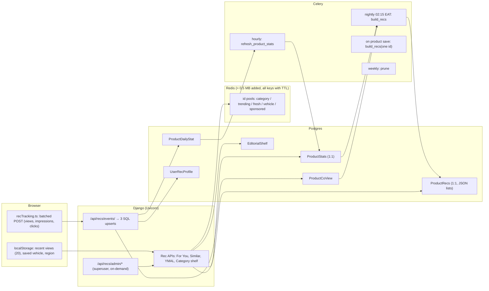

# SokoniMax Recommendation System v3 — Complete Implementation Plan

> **Version:** 1.0 · **Date:** 2026-10-14 · **Repo:** `~/uzaspea` (WSL Ubuntu) · **Stack:** Django 5.1.2 + DRF 3.15 + Celery 5.6 + Redis + Postgres 15 / React + Vite + TS (strict)
>
> **Decisions locked by the owner:** 2-server production (64 MB Redis) · store last 20 viewed IDs for logged-in users + anonymous counts · **fixed labelled sponsored slot** (max 1 in 8) · plan stored in repo `docs/` and on `D:\`.

---

## 0. RULES FOR THE IMPLEMENTING AGENT (read fully before touching code)

1. **Do the steps in order.** Every step ends with a **Check**. Do not start the next step until the Check passes.
2. **"Create file"** = the file must not exist; create it with exactly the content given.
   **"Replace whole file"** = overwrite the file completely with the content given.
   **"Find / Replace"** = locate the *Find* text (match by content, not line numbers — line numbers drift) and replace only that text.
3. If a *Find* anchor is not found exactly, search for the closest match (e.g. whitespace differences). If you still cannot find it, **stop and report** — never guess-delete code.
4. **Line endings:** `backend/marketplace/api_views.py`, `backend/marketplace/tests.py`, `frontend/src/pages/ProductDetailPage.tsx`, `frontend/src/App.tsx` use **CRLF**. Keep CRLF in those files. All new files use LF.
5. The owner has **uncommitted work** in some files (e.g. `CategoryBar.tsx`, `ProductDetailPage.tsx`). **Never** run `git checkout -- <file>`, `git stash`, or `git reset`. Only add the edits described.
6. **No new pip or npm packages.** Everything uses existing dependencies.
7. Backend commands are run as:
   ```bash
   cd ~/uzaspea/backend && source venv/bin/activate
   ```
   Frontend commands are run from `~/uzaspea/frontend`.
8. TypeScript is `strict` with `noUnusedLocals` and `noUnusedParameters`. **Every import you add must be used; every import you make unused must be removed.**
9. Do not "improve" anything not listed. Do not rename existing functions, URLs, or components unless told.

---

## 1. WHAT THIS BUILDS (summary)

| Surface | Before | After |
|---|---|---|
| **For You** (`/products`, no filters) | 5 hard-coded category shelves, same for everyone | Personal shelves (Because you viewed X · Recently viewed · Fits your vehicle · Similar to saved · Goes with purchases · Picks in your top category) + Trending (region) + **editorial shelves ranked by the visitor's interests** (admin-editable) + Fresh picks. Gender inferred, visible Women/Men toggle. |
| **Similar Products** (detail) | Same category, newest, pagination broken | Precomputed substitutes (text/brand/price/condition/quality/popularity), consistent pagination, shared cache |
| **You Might Also Like** (detail) | Overlapped with Similar, leaked user data via shared cache | Complements (co-viewed, co-bought, related categories, same vehicle, same seller) re-ranked for the visitor, lazy-loaded, never cached per user |
| **Category shelf** (inside category grid) | Duplicates, wrong cache | Popular-in-category, personal re-rank, no duplicates |
| **Sponsored** | +20 score boost (actually broken) | Max 1 labelled slot per 8 items, only if relevant |
| **New listings** | Disappear behind old items | 1 exploration slot per 8 for listings < 7 days old |
| **Admin** | Nothing | **Recommendations Inspector** in `/staff-admin/recommendations`: users list → signals + top 5 items for every reason with full score breakdown; product inspector; visitor simulator; health/CTR dashboard |
| **Security** | `buying_price` (cost) public in every card | Visible only to seller, team members with `manage_products`, staff |

**Bugs fixed (all verified on dev DB):** BUG-1 quality/sponsor signals never applied · BUG-2 all guests share one "personal" result · BUG-3 cache ignores `limit`/`exclude` · BUG-4 detail cache leaks personal data · BUG-5 cost price public · BUG-6 similar pagination mismatch · BUG-7 shelf duplicates, unordered purchases, `int(limit)` 500, vehicle never used.

---

## 2. ARCHITECTURE AND RESOURCE BUDGET



### Resource budget (2-server production)

| Resource | Added cost | Saved |
|---|---|---|
| Redis (64 MB) | ≈ 0.3–0.6 MB of ID pools, all with TTL | Per-user rec keys removed; `volatile-lru` protects Celery queues + sessions |
| Postgres (384 MB) | 7 small tables: `ProductRecs` ≈ 3 KB/product (2,000 products ≈ 6 MB), `ProductCoView` ≤ 30 rows/product, `ProductDailyStat` ≤ 35 days | Rec cards read stats via 1 join instead of 4–6 correlated subqueries |
| Celery worker (200 MB) | Hourly stats ≤ 5 s; nightly build: seconds to ~1 min, < 80 MB RAM | — |
| Backend CPU | Re-rank ≤ 100 IDs per shelf (< 3 ms) | Detail page similar list = 1 PK read |
| Bandwidth | ≤ 1 tracking POST / 30 s / active tab (< 1 KB) | YMAL only fetched when scrolled near |

### Cost for the admin to use the Inspector (answers the owner's question)

| Admin action | DB work | Time | Memory | Stored |
|---|---|---|---|---|
| Open user list (20 rows) | 5 small queries | ≈ 15 ms | negligible | nothing |
| Open one user (all reasons × 5 items + breakdowns) | ≈ 15–20 queries | 80–150 ms | < 2 MB briefly | 1 Redis key ≈ 5 KB for 5 min |
| Product inspector | ≈ 8 queries | ≈ 40 ms | negligible | nothing |
| Simulate visitor | same as one user | 80–150 ms | < 2 MB | nothing |
| Health page | reads all `ProductRecs` once | ≈ 0.3 s first time | ≈ 6 MB briefly | 1 Redis key, 1 h |
| **When no admin is looking** | **0** | **0** | **0** | **0** |

---

## 3. FILE MAP

**New backend files**
```
backend/marketplace/recs/__init__.py
backend/marketplace/recs/config.py
backend/marketplace/recs/scoring.py
backend/marketplace/recs/queries.py
backend/marketplace/recs/context.py
backend/marketplace/recs/builder.py
backend/marketplace/recs/engine.py
backend/marketplace/recs/serializers.py
backend/marketplace/recs/events.py
backend/marketplace/recs/views.py
backend/marketplace/management/commands/build_recs.py
backend/marketplace/migrations/01XX_recommendations_v3.py        (generated)
backend/marketplace/migrations/01XX_seed_editorial_shelves.py    (generated empty, then filled)
```
**Changed backend files:** `marketplace/models.py`, `marketplace/serializers.py`, `marketplace/api_views.py`, `marketplace/discovery_views.py`, `marketplace/recommendation_service.py` (becomes a shim), `marketplace/urls.py`, `marketplace/tasks.py`, `marketplace/admin.py`, `marketplace/test_recommendations.py` (replaced), `uzachuo/celery.py`, `uzachuo/settings.py`, `docker-compose.data.yml`, `docker-compose.prod.yml`, `docker-compose.yml`.

**New frontend files:** `frontend/src/utils/recTracking.ts`, `frontend/src/pages/staff/RecommendationInspector.tsx`

**Changed frontend files:** `utils/recentViews.ts`, `utils/productCache.ts`, `components/ProductCard.tsx`, `components/YouMightAlsoLikeSection.tsx`, `components/SimilarProductsSection.tsx`, `components/discovery/DiscoveryShelf.tsx`, `components/discovery/DiscoveryFeed.tsx` (replaced), `components/discovery/CategoryRecommendationShelf.tsx` (replaced), `components/GlobalSearchModal.tsx`, `pages/ProductDetailPage.tsx`, `pages/ProductList.tsx`, `pages/staff/StaffAdminLayout.tsx`.

---

## 4. API CONTRACTS (what the frontend and backend agree on)

| Method + URL | Auth | Query / body | Response |
|---|---|---|---|
| `GET /api/products/discovery/` | any | `recent_ids`, `vehicle_id`, `region`, `gender` (all optional) | `{status, personalized, sections:[{id, kind, type, title, subtitle, category_slug, see_more_url, paginated, has_gender_toggle, gender_active, shelf_score, products:[card]}]}` |
| `GET /api/products/discovery/?section_id=shelf:<key>&page=N&page_size=12` | any | — | `{status, section_id, page, has_more, products}` |
| `GET /api/recs/products/<id>/similar/?page=&page_size=` | any | — | `{product_id, page, has_more, products}` |
| `GET /api/recs/products/<id>/ymal/?limit=` | any | `recent_ids, vehicle_id, region, exclude, cart_ids` | `{product_id, title, products}` |
| `GET /api/products/recommendations/` | any | `category` or `product_id`, `limit`, `exclude`, `recent_ids`, `vehicle_id`, `region` | `{product_id, category, category_name, title, subtitle, products}` |
| `POST /api/recs/events/` | any (JWT optional) | `{views:[ids], impressions:{surface:n}, clicks:[{s,p}], vehicle_id, region}` | `204` |
| `GET /api/recs/admin/users/?q=&page=` | superuser | — | `{count, page, page_size, results:[...]}` |
| `GET /api/recs/admin/users/<id>/?refresh=1` | superuser | — | inspector payload |
| `GET /api/recs/admin/products/?q=<id or slug>` | superuser | — | `{product, stats, recs_computed_at, reasons}` |
| `POST /api/recs/admin/simulate/` | superuser | `{recent_ids, vehicle_id, region, gender}` | inspector payload |
| `GET /api/recs/admin/health/?refresh=1` | superuser | — | metrics |

**Card** = existing `ProductListSerializer` fields **minus `buying_price`**, description truncated to 160 chars, plus `rec_slot` (`''`, `'sponsored'`, `'explore'`).

**Inspector payload** = `{signals:{recent, liked, purchased, vehicle_id, vehicle, region, gender, top_categories}, reasons:[{id, kind, title, shelf_score, items:[{id, name, slug, price, image, category, seller, score, slot, reason, breakdown}]}], weights, generated_at, cached?, user?}`.

---

## 5. STEPS

### STEP 0 — Pre-flight

```bash
cd ~/uzaspea
git checkout -b feature/recs-v3
cd backend && source venv/bin/activate
python manage.py makemigrations --check --dry-run
```
- If the output lists **only** `staff/migrations/0006_alter_staffpermission_permission.py` (a choices sync that already existed before this work), run:
  ```bash
  python manage.py makemigrations staff
  git add staff/migrations && git commit -m "chore(staff): sync StaffPermission choices migration"
  ```
- If it lists **any marketplace migration**, STOP and report (unrelated drift must not be mixed in).

Baseline:
```bash
python manage.py test marketplace -v 1 2>&1 | tail -5        # write down the result
cd ../frontend && npx tsc -p tsconfig.app.json --noEmit; echo "tsc exit $?"
```
Write down pre-existing failures. Your work must not add new ones.

**Check:** `git branch --show-current` prints `feature/recs-v3`; `makemigrations --check` now prints `No changes detected`.

---

### STEP 1 — Models (`backend/marketplace/models.py`)

**1a. Find** (inside `class Category`):
```python
    brands = models.ManyToManyField(Brand, blank=True, related_name='categories', help_text="Brands applicable to this category")
```
**Replace with:**
```python
    brands = models.ManyToManyField(Brand, blank=True, related_name='categories', help_text="Brands applicable to this category")
    related_categories = models.ManyToManyField(
        'self', symmetrical=True, blank=True,
        help_text="Complementary categories used by 'You Might Also Like' (e.g. Mobile Phones <-> Phone Accessories)"
    )
```

**1b. Append to the very end of `models.py`:**
```python


# ═══════════════════════════════════════════════════════════════════
# Recommendation System v3
# ═══════════════════════════════════════════════════════════════════

class ProductStats(models.Model):
    """Denormalised per-product signals. Refreshed hourly by marketplace.tasks.refresh_product_stats_task."""
    product = models.OneToOneField(Product, on_delete=models.CASCADE, primary_key=True, related_name='stats')
    views_7d = models.PositiveIntegerField(default=0)
    views_30d = models.PositiveIntegerField(default=0)
    likes = models.PositiveIntegerField(default=0)
    orders_7d = models.PositiveIntegerField(default=0)
    orders_30d = models.PositiveIntegerField(default=0)
    rating_avg = models.FloatField(default=0.0)
    rating_count = models.PositiveIntegerField(default=0)
    has_inspection = models.BooleanField(default=False)
    inspection_verdict = models.CharField(max_length=20, blank=True, default='')
    inspection_pass = models.BooleanField(default=False)
    popularity = models.FloatField(default=0.0, db_index=True)
    quality = models.FloatField(default=0.0)
    updated_at = models.DateTimeField(auto_now=True)

    def __str__(self):
        return f"Stats for product {self.product_id}"


class ProductRecs(models.Model):
    """Precomputed neighbours. Each list item: [product_id, score, [component values]] best first."""
    product = models.OneToOneField(Product, on_delete=models.CASCADE, primary_key=True, related_name='recs')
    similar = models.JSONField(default=list, blank=True)
    complements = models.JSONField(default=list, blank=True)
    computed_at = models.DateTimeField(auto_now=True)

    def __str__(self):
        return f"Recs for product {self.product_id}"


class ProductDailyStat(models.Model):
    product = models.ForeignKey(Product, on_delete=models.CASCADE, related_name='daily_stats')
    date = models.DateField()
    views = models.PositiveIntegerField(default=0)
    rec_clicks = models.PositiveIntegerField(default=0)

    class Meta:
        constraints = [models.UniqueConstraint(fields=['product', 'date'], name='uniq_product_daily_stat')]
        indexes = [models.Index(fields=['date'], name='mkt_pds_date_idx')]


class ProductCoView(models.Model):
    """Directed pair counts: visitors who viewed product_a also viewed product_b (within 2 steps)."""
    product_a = models.ForeignKey(Product, on_delete=models.CASCADE, related_name='+')
    product_b = models.ForeignKey(Product, on_delete=models.CASCADE, related_name='+')
    hits = models.PositiveIntegerField(default=0)
    last_seen = models.DateField()

    class Meta:
        constraints = [models.UniqueConstraint(fields=['product_a', 'product_b'], name='uniq_product_coview')]
        indexes = [models.Index(fields=['product_a', '-hits'], name='mkt_coview_a_hits_idx')]


class RecSurfaceDailyStat(models.Model):
    """Impressions and clicks per recommendation surface per day (for CTR)."""
    date = models.DateField()
    surface = models.CharField(max_length=30)
    impressions = models.PositiveIntegerField(default=0)
    clicks = models.PositiveIntegerField(default=0)

    class Meta:
        constraints = [models.UniqueConstraint(fields=['date', 'surface'], name='uniq_rec_surface_day')]


class UserRecProfile(models.Model):
    """Server-side memory for logged-in users only (max 20 recent product ids)."""
    user = models.OneToOneField(User, on_delete=models.CASCADE, primary_key=True, related_name='rec_profile')
    recent_ids = models.JSONField(default=list, blank=True)
    vehicle_id = models.PositiveIntegerField(null=True, blank=True)
    region = models.CharField(max_length=64, blank=True, default='')
    updated_at = models.DateTimeField(auto_now=True)

    def __str__(self):
        return f"Rec profile for user {self.user_id}"


class EditorialShelf(models.Model):
    """Admin-managed shelves on the For You page. Order is personalised per visitor."""
    AUDIENCE_CHOICES = [('all', 'Everyone'), ('female', 'Female'), ('male', 'Male')]

    key = models.SlugField(max_length=50, unique=True)
    title = models.CharField(max_length=80)
    subtitle = models.CharField(max_length=160, blank=True, default='')
    category = models.ForeignKey(Category, on_delete=models.CASCADE, related_name='editorial_shelves')
    audience = models.CharField(max_length=10, choices=AUDIENCE_CHOICES, default='all')
    base_order = models.PositiveSmallIntegerField(default=100, help_text="Lower = higher on the page for visitors with no history")
    is_active = models.BooleanField(default=True)

    class Meta:
        ordering = ['base_order', 'id']

    def __str__(self):
        return f"{self.title} ({self.key})"


@receiver(post_save, sender=Product)
def recs_on_product_saved(sender, instance, created, **kwargs):
    """Ensure a stats row exists and (debounced) rebuild this product's recommendation lists."""
    if kwargs.get('raw'):
        return
    try:
        ProductStats.objects.get_or_create(product_id=instance.pk)
    except Exception:
        return
    if instance.is_draft or not instance.is_available:
        return
    from django.db import transaction

    def _enqueue():
        try:
            if cache.add(f"recs:v3:rebuild:{instance.pk}", 1, 600):
                from .tasks import build_recs_for_product_task
                build_recs_for_product_task.delay(instance.pk)
        except Exception:
            pass

    transaction.on_commit(_enqueue)
```
> `User`, `receiver`, `post_save`, and `cache` are already imported/defined earlier in `models.py`. Verify with `grep -n "^from django.core.cache import cache\|^from django.dispatch import receiver\|post_save" backend/marketplace/models.py | head`. If `cache` is imported only inside a function, add `from django.core.cache import cache` directly above the new block.

**Check:**
```bash
python -c "import django,os;os.environ.setdefault('DJANGO_SETTINGS_MODULE','uzachuo.settings');django.setup();from marketplace.models import ProductStats,ProductRecs,EditorialShelf;print('ok')"
```
prints `ok`.

---

### STEP 2 — Migrations

```bash
python manage.py makemigrations marketplace -n recommendations_v3
```
Open the generated file. It must contain **only**: `AddField related_categories` on category, and `CreateModel` for `EditorialShelf, ProductCoView, ProductDailyStat, ProductRecs, ProductStats, RecSurfaceDailyStat, UserRecProfile` (+ their constraints/indexes). Anything else → STOP and report.

```bash
python manage.py makemigrations marketplace --empty -n seed_editorial_shelves
```
Open the new empty file. **Keep its generated `dependencies = [...]` line exactly**, and replace everything else so the file reads:
```python
from django.db import migrations

# (key, title, subtitle, category slug, fallback name keywords, audience, base_order)
SHELVES = [
    ('womens-fashion', 'Look Different', 'Trendy styles, dresses, shoes & beauty picks', 'womens-fashion', ["Women's Fashion", 'Women'], 'female', 10),
    ('mens-fashion', 'Look Different', 'Sharp looks, shoes & style essentials for men', 'mens-fashion', ["Men's Fashion", 'Men Fashion'], 'male', 10),
    ('for-your-car', 'For Your Car', 'Spare parts, accessories & vehicles', 'vehicles', ['Vehicles', 'Vehicle Parts', 'Cars'], 'all', 20),
    ('phone-deals', 'Deals in Phones', 'Smartphones, accessories & gadgets', 'electronics-mobile-phones', ['Mobile Phones', 'Phones', 'Electronics'], 'all', 30),
    ('home-living', 'Home & Living', 'Furniture, kitchen & home appliances', 'home-garden-furniture', ['Home', 'Furniture', 'Appliances'], 'all', 40),
]


def seed(apps, schema_editor):
    Category = apps.get_model('marketplace', 'Category')
    EditorialShelf = apps.get_model('marketplace', 'EditorialShelf')
    for key, title, subtitle, slug, keywords, audience, order in SHELVES:
        category = Category.objects.filter(slug=slug).first()
        if category is None:
            for kw in keywords:
                category = Category.objects.filter(name__icontains=kw).order_by('id').first()
                if category is not None:
                    break
        if category is None:
            continue
        EditorialShelf.objects.update_or_create(
            key=key,
            defaults={'title': title, 'subtitle': subtitle, 'category': category,
                      'audience': audience, 'base_order': order, 'is_active': True},
        )


def unseed(apps, schema_editor):
    apps.get_model('marketplace', 'EditorialShelf').objects.filter(key__in=[s[0] for s in SHELVES]).delete()


class Migration(migrations.Migration):

    dependencies = [
        # KEEP THE GENERATED DEPENDENCY LINE HERE
    ]

    operations = [
        migrations.RunPython(seed, unseed),
    ]
```
```bash
python manage.py migrate marketplace
python manage.py makemigrations --check --dry-run
```
**Check:** migrate succeeds; the check prints `No changes detected`.

---

### STEP 3 — Hide cost price (`backend/marketplace/serializers.py`)

**3a.** Find the line `class ProductSerializer(serializers.ModelSerializer):`. **Directly above it**, insert:
```python
def user_can_view_cost(user, seller_id, memo=None):
    """True if `user` may see a product's buying_price (seller, team member with manage_products, or staff)."""
    if not user or not getattr(user, 'is_authenticated', False):
        return False
    if user.is_superuser or user.is_staff or user.id == seller_id:
        return True
    if memo is not None and 'effective' in memo:
        effective = memo['effective']
    else:
        try:
            from uzachuo.permissions import get_effective_sellers
            effective = {getattr(x, 'id', x) for x in get_effective_sellers(user, required_permission='manage_products')}
        except Exception:
            effective = set()
        if memo is not None:
            memo['effective'] = effective
    return seller_id in effective


class CostPriceVisibilityMixin:
    """Removes buying_price from serializer output unless the viewer may see it."""
    def to_representation(self, instance):
        ret = super().to_representation(instance)
        if 'buying_price' in ret:
            request = self.context.get('request')
            memo = self.context.setdefault('_cost_visibility_memo', {})
            if not user_can_view_cost(getattr(request, 'user', None), getattr(instance, 'seller_id', None), memo):
                ret.pop('buying_price', None)
        return ret


```
**3b. Find:** `class ProductSerializer(serializers.ModelSerializer):`
**Replace:** `class ProductSerializer(CostPriceVisibilityMixin, serializers.ModelSerializer):`

**3c. Find:** `class ProductListSerializer(serializers.ModelSerializer):`
**Replace:** `class ProductListSerializer(CostPriceVisibilityMixin, serializers.ModelSerializer):`

> If either class already defines its own `to_representation`, keep it — the mixin's version runs after it through `super()`, so nothing else changes.

**Check:** `python manage.py check` → `System check identified no issues`.

---

### STEP 4 — Package skeleton + config

Create `backend/marketplace/recs/__init__.py`:
```python
"""Recommendation system v3 (see docs/RECOMMENDATIONS_PLAN.md)."""
```

Create `backend/marketplace/recs/config.py`:
```python
"""Recommendation system v3 - every tunable number lives here.

IMPORTANT: the KEY ORDER of W_SIMILAR and W_COMPLEMENT defines the order of the component values stored in
ProductRecs. If you add/remove/reorder keys, run `python manage.py build_recs` afterwards.
"""

CACHE_PREFIX = "recs:v3"

# Precompute (stored per product in ProductRecs)
SIMILAR_STORE = 36
COMPLEMENT_STORE = 36
MAX_CANDIDATES_PER_PRODUCT = 600
SIMILAR_MIN_SAME_CATEGORY = 8
SIBLING_CATEGORY_FACTOR = 0.6
COMPLEMENT_CATEGORY_TAKE = 40

# Online pools (Redis, ids only, always with TTL)
POOL_SIZE = 60
POOL_TTL = 900
TREND_TTL = 3600
SPONSORED_TTL = 300
INSPECT_TTL = 300
COLD_FEED_TTL = 300
HEALTH_TTL = 3600

# Shelves
SHELF_SIZE = 16
MIN_SHELF_ITEMS = 4
MAX_BECAUSE_SHELVES = 2

# Diversity and slots
MAX_PER_SELLER = 2
MAX_PER_CATEGORY = 3
SLOT_EVERY = 8
SPONSORED_SLOT_INDEX = 2      # 3rd card of every block of 8
EXPLORE_SLOT_INDEX = 6        # 7th card of every block of 8
SPONSORED_MIN_RELEVANCE = 0.35  # sponsored item must score >= 35% of the best item to be shown
NEW_LISTING_DAYS = 7
EXPLORE_MAX_POPULARITY = 0.2
FALLBACK_FACTOR = 0.5

# Signals
RECENT_MAX = 20
COVIEW_WINDOW = 2
MAX_PAIRS_PER_BEACON = 40
MAX_VIEWS_PER_BEACON = 30
MAX_IMPRESSIONS_PER_SURFACE = 50
DAILY_STATS_KEEP_DAYS = 35
SURFACE_STATS_KEEP_DAYS = 120
COVIEW_KEEP_PER_PRODUCT = 30
COVIEW_MAX_AGE_DAYS = 180

PRICE_BAND_LOG10 = 0.5   # price similarity reaches 0 at ~3.2x price difference

W_SIMILAR = {'text': 0.35, 'price': 0.20, 'brand': 0.15, 'condition': 0.10, 'quality': 0.10, 'popularity': 0.10}
W_COMPLEMENT = {'coview': 0.35, 'copurchase': 0.25, 'category': 0.15, 'popularity': 0.15, 'quality': 0.10}
W_PERSONAL = {'affinity': 0.30, 'vehicle': 0.20, 'region': 0.10, 'freshness': 0.10}
W_POOL = {'popularity': 0.6, 'quality': 0.4}

PAID_STATUSES = (
    'PAID', 'PAID_PRODUCT', 'SELLER_CONFIRMED', 'PREPARING', 'PACKAGING', 'SHIPPED_TO_WAREHOUSE',
    'RECEIVED_AT_WAREHOUSE', 'ASSIGNED_TRANSPORT', 'IN_TRANSIT', 'ARRIVED_AT_REGIONAL_WAREHOUSE',
    'READY_FOR_PICKUP', 'READY_FOR_VEHICLE_HANDOVER', 'PROCESSING', 'SHIPPED', 'OUT_FOR_DELIVERY',
    'DELIVERED', 'COMPLETED',
)

SURFACES = ('similar', 'ymal', 'foryou', 'cat_shelf', 'cart', 'empty_search')

STOPWORDS = {
    'the', 'and', 'for', 'with', 'new', 'used', 'original', 'genuine', 'quality', 'best', 'sale', 'pcs',
    'set', 'of', 'in', 'to', 'an', 'na', 'ya', 'kwa', 'za', 'la', 'cha', 'mpya', 'bei',
}
```

**Check:** `python -c "import marketplace.recs.config as c; print(c.SHELF_SIZE)"` (from `backend/`) prints `16`.

---

### STEP 5 — `backend/marketplace/recs/scoring.py` (create)
```python
"""Pure scoring helpers (no database access)."""
import math
import re

from . import config

_TOKEN_RE = re.compile(r"[a-z0-9]+")


def tokenize(*parts):
    out = set()
    for part in parts:
        if not part:
            continue
        for tok in _TOKEN_RE.findall(str(part).lower()):
            if len(tok) >= 2 and tok not in config.STOPWORDS:
                out.add(tok)
    return out


def spec_tokens(specs):
    if not isinstance(specs, dict):
        return set()
    values = [v for v in specs.values() if isinstance(v, (str, int, float)) and len(str(v)) <= 30]
    return tokenize(*values)


def jaccard(a, b):
    if not a or not b:
        return 0.0
    inter = len(a & b)
    return inter / float(len(a | b)) if inter else 0.0


def price_sim(p, q):
    try:
        p, q = float(p), float(q)
    except (TypeError, ValueError):
        return 0.0
    if p <= 0 or q <= 0:
        return 0.0
    return max(0.0, 1.0 - abs(math.log10(p / q)) / config.PRICE_BAND_LOG10)


def raw_popularity(views_7d, likes, orders_30d):
    return math.log1p(4 * (orders_30d or 0) + 2 * (likes or 0) + (views_7d or 0))


def quality_score(inspection_pass, seller_verified, rating_avg, rating_count):
    rating_part = (float(rating_avg or 0) / 5.0) * min(1.0, (rating_count or 0) / 3.0)
    value = 0.4 * (1.0 if inspection_pass else 0.0) + 0.3 * (1.0 if seller_verified else 0.0) + 0.3 * rating_part
    return round(value, 4)


def weighted(components, weights):
    """Returns (total, breakdown) where breakdown[key] = weight * value."""
    breakdown, total = {}, 0.0
    for key, weight in weights.items():
        part = weight * float(components.get(key, 0.0) or 0.0)
        breakdown[key] = round(part, 4)
        total += part
    return round(total, 4), breakdown
```

---

### STEP 6 — `backend/marketplace/recs/queries.py` (create)
```python
"""Shared DB/Redis helpers. Redis only ever stores small lists of integer ids, always with a TTL."""
import re

from django.core.cache import cache
from django.db.models import F, Q
from django.utils import timezone

from marketplace.models import Product, Like, SponsoredListing
from . import config

ACTIVE = {'is_available': True, 'is_draft': False, 'stock__gt': 0}


def cache_key(*parts):
    clean = [re.sub(r'[^a-z0-9]+', '-', str(p).lower()).strip('-') or 'none' for p in parts]
    return ':'.join([config.CACHE_PREFIX] + clean)


def popularity_order():
    return [F('stats__popularity').desc(nulls_last=True), '-created_at', 'id']


def card_queryset():
    return (Product.objects.filter(**ACTIVE)
            .select_related('seller', 'seller__profile', 'category', 'category__parent', 'stats')
            .prefetch_related('images', 'variants', 'price_tiers'))


def hydrate(ids):
    """Active products for `ids`, in the same order. Unavailable ids are silently dropped."""
    ids = [int(i) for i in ids if i]
    if not ids:
        return []
    order = {pid: idx for idx, pid in enumerate(ids)}
    items = list(card_queryset().filter(id__in=list(order)))
    items.sort(key=lambda p: order[p.id])
    return items


def active_sponsored_ids():
    key = cache_key('sponsored')
    ids = cache.get(key)
    if ids is None:
        now = timezone.now()
        ids = list(SponsoredListing.objects.filter(status='approved')
                   .filter(Q(expires_at__gt=now) | Q(expires_at__isnull=True))
                   .values_list('product_id', flat=True).distinct())
        cache.set(key, ids, config.SPONSORED_TTL)
    return set(ids)


def liked_ids(user, product_ids):
    if not user or not getattr(user, 'is_authenticated', False) or not product_ids:
        return set()
    return set(Like.objects.filter(user=user, product_id__in=list(product_ids)).values_list('product_id', flat=True))


def category_ids_with_descendants(category):
    key = cache_key('catdesc', category.id)
    ids = cache.get(key)
    if ids is None:
        ids = list(category.get_descendants(include_self=True).values_list('id', flat=True))
        cache.set(key, ids, 3600)
    return ids


def category_pool(category_id):
    """Top POOL_SIZE active products in a category (and its children) by popularity, then newest."""
    key = cache_key('catpool', category_id)
    ids = cache.get(key)
    if ids is None:
        from marketplace.models import Category
        category = Category.objects.filter(id=category_id).first()
        if category is None:
            return []
        cat_ids = category_ids_with_descendants(category)
        ids = list(Product.objects.filter(category_id__in=cat_ids, **ACTIVE)
                   .order_by(*popularity_order()).values_list('id', flat=True)[:config.POOL_SIZE])
        cache.set(key, ids, config.POOL_TTL)
    return ids


def trending_pool(region=None):
    region = (region or '').strip()
    key = cache_key('trend', region or 'all')
    ids = cache.get(key)
    if ids is None:
        qs = Product.objects.filter(**ACTIVE)
        if region:
            qs = qs.filter(Q(location_name__icontains=region) | Q(seller__profile__location__icontains=region))
        ids = list(qs.order_by(*popularity_order()).values_list('id', flat=True)[:config.POOL_SIZE])
        if region and len(ids) < config.MIN_SHELF_ITEMS * 2:
            national = trending_pool(None)
            ids = (ids + [i for i in national if i not in ids])[:config.POOL_SIZE]
        cache.set(key, ids, config.TREND_TTL)
    return ids


def fresh_pool():
    key = cache_key('fresh')
    ids = cache.get(key)
    if ids is None:
        ids = list(Product.objects.filter(**ACTIVE).order_by('-created_at', '-id')
                   .values_list('id', flat=True)[:config.POOL_SIZE])
        cache.set(key, ids, config.POOL_TTL)
    return ids


def vehicle_pool(vehicle_id):
    if not vehicle_id:
        return []
    key = cache_key('veh', vehicle_id)
    ids = cache.get(key)
    if ids is None:
        ids = list(Product.objects.filter(fitments__vehicle_id=vehicle_id, **ACTIVE)
                   .order_by(*popularity_order()).values_list('id', flat=True)[:config.POOL_SIZE])
        cache.set(key, ids, config.POOL_TTL)
    return ids
```

---

### STEP 7 — `backend/marketplace/recs/context.py` (create)
```python
"""Builds the per-request recommendation context (signals) for a visitor or for the admin inspector."""
from collections import Counter
from dataclasses import dataclass, field

from marketplace.models import Product, Like, OrderItem, UserRecProfile
from . import config


@dataclass
class RecContext:
    user: object = None
    recent_ids: list = field(default_factory=list)      # most recent first
    liked_ids: list = field(default_factory=list)
    purchased_ids: list = field(default_factory=list)
    cart_ids: set = field(default_factory=set)
    exclude_ids: set = field(default_factory=set)
    seen_ids: set = field(default_factory=set)          # never recommended again (recent + purchased + cart)
    vehicle_id: int = None
    region: str = ''
    gender: str = ''
    cat_affinity: dict = field(default_factory=dict)    # category_id -> 0..1
    top_category_ids: list = field(default_factory=list)
    product_info: dict = field(default_factory=dict)    # product_id -> row (name, category ids/slugs)

    @property
    def has_signals(self):
        return bool(self.recent_ids or self.liked_ids or self.purchased_ids or self.vehicle_id)


def parse_id_list(raw, cap):
    out = []
    if raw is None:
        return out
    items = raw if isinstance(raw, (list, tuple, set)) else str(raw).split(',')
    for item in items:
        text = str(item).strip()
        if text.isdigit():
            value = int(text)
            if value > 0 and value not in out:
                out.append(value)
        if len(out) >= cap:
            break
    return out


def build_context(user=None, recent_ids=None, vehicle_id=None, region='', gender='',
                  exclude_ids=None, cart_ids=None, use_stored_profile=True):
    ctx = RecContext()
    if user is not None and getattr(user, 'is_authenticated', False):
        ctx.user = user
    ctx.recent_ids = parse_id_list(recent_ids, config.RECENT_MAX)
    ctx.vehicle_id = vehicle_id if isinstance(vehicle_id, int) and vehicle_id > 0 else None
    ctx.region = (region or '').strip()[:64]
    ctx.exclude_ids = set(parse_id_list(exclude_ids, 200))
    ctx.cart_ids = set(parse_id_list(cart_ids, 50))
    if gender in ('female', 'male'):
        ctx.gender = gender

    if ctx.user is not None:
        if use_stored_profile:
            prof = UserRecProfile.objects.filter(user=ctx.user).first()
            if prof:
                for pid in prof.recent_ids or []:
                    if isinstance(pid, int) and pid not in ctx.recent_ids:
                        ctx.recent_ids.append(pid)
                ctx.recent_ids = ctx.recent_ids[:config.RECENT_MAX]
                ctx.vehicle_id = ctx.vehicle_id or prof.vehicle_id
                ctx.region = ctx.region or (prof.region or '')
        ctx.liked_ids = list(Like.objects.filter(user=ctx.user).order_by('-created_at')
                             .values_list('product_id', flat=True)[:20])
        purchased = (OrderItem.objects.filter(order__user=ctx.user, order__status__in=config.PAID_STATUSES)
                     .order_by('-order__order_date').values_list('product_id', flat=True)[:40])
        ctx.purchased_ids = list(dict.fromkeys(purchased))[:20]
        if not ctx.gender:
            profile_gender = getattr(getattr(ctx.user, 'profile', None), 'gender', '')
            if profile_gender in ('female', 'male'):
                ctx.gender = profile_gender

    ctx.seen_ids = set(ctx.recent_ids) | set(ctx.purchased_ids) | set(ctx.cart_ids)
    _compute_affinity(ctx)
    if not ctx.gender:
        ctx.gender = _infer_gender(ctx)
    return ctx


def _compute_affinity(ctx):
    ids = set(ctx.recent_ids) | set(ctx.liked_ids) | set(ctx.purchased_ids)
    if not ids:
        return
    rows = Product.objects.filter(id__in=ids).values(
        'id', 'name', 'category_id', 'category__parent_id', 'category__slug', 'category__parent__slug', 'category__name')
    ctx.product_info = {r['id']: r for r in rows}
    weights = Counter()

    def add(pid, w):
        row = ctx.product_info.get(pid)
        if not row:
            return
        weights[row['category_id']] += w
        if row['category__parent_id']:
            weights[row['category__parent_id']] += w * 0.5

    for rank_index, pid in enumerate(ctx.recent_ids):
        add(pid, 1.0 / (1.0 + 0.15 * rank_index))
    for pid in ctx.liked_ids:
        add(pid, 1.5)
    for pid in ctx.purchased_ids:
        add(pid, 1.0)
    if weights:
        top = max(weights.values())
        ctx.cat_affinity = {cid: round(w / top, 4) for cid, w in weights.items()}
        ctx.top_category_ids = [cid for cid, _ in weights.most_common(5)]


def _infer_gender(ctx):
    female = male = 0
    for row in ctx.product_info.values():
        slugs = f"{row.get('category__slug') or ''} {row.get('category__parent__slug') or ''}".lower()
        if 'women' in slugs or 'ladies' in slugs:
            female += 1
        elif 'men' in slugs:
            male += 1
    if female >= 2 and female > male:
        return 'female'
    if male >= 2 and male > female:
        return 'male'
    return ''


def context_from_request(request):
    qp = request.query_params
    raw_vehicle = qp.get('vehicle_id') or ''
    return build_context(
        user=request.user,
        recent_ids=qp.get('recent_ids'),
        vehicle_id=int(raw_vehicle) if raw_vehicle.isdigit() else None,
        region=qp.get('region') or '',
        gender=qp.get('gender') or '',
        exclude_ids=qp.get('exclude'),
        cart_ids=qp.get('cart_ids'),
    )
```

---

### STEP 8 — `backend/marketplace/recs/builder.py` (create)
```python
"""Offline builders for recommendations v3. All functions are safe to re-run at any time.

refresh_product_stats()   hourly   -> ProductStats
build_recs(only_ids=None) nightly + on product save -> ProductRecs
prune_rec_data()          weekly   -> trims old/weak signal rows
"""
import logging
from collections import Counter, defaultdict
from datetime import timedelta

from django.db.models import Avg, Count, Sum
from django.utils import timezone

from marketplace.models import (
    Product, Category, Like, OrderItem, Review, ProductVehicleFitment,
    ProductStats, ProductRecs, ProductDailyStat, ProductCoView, RecSurfaceDailyStat,
)
from . import config
from .scoring import tokenize, spec_tokens, jaccard, price_sim, raw_popularity, quality_score, weighted

logger = logging.getLogger(__name__)

STATS_FIELDS = ['views_7d', 'views_30d', 'likes', 'orders_7d', 'orders_30d', 'rating_avg', 'rating_count',
                'has_inspection', 'inspection_verdict', 'inspection_pass', 'popularity', 'quality', 'updated_at']


def _active():
    return Product.objects.filter(is_available=True, is_draft=False, stock__gt=0)


# ─── Hourly: ProductStats ──────────────────────────────────────────
def refresh_product_stats():
    now = timezone.now()
    today = timezone.localdate()
    products = list(_active().order_by().values('id', 'seller__profile__is_verified'))
    if not products:
        return 0

    def summed_views(days):
        return dict(ProductDailyStat.objects.filter(date__gte=today - timedelta(days=days)).order_by()
                    .values('product_id').annotate(n=Sum('views')).values_list('product_id', 'n'))

    def paid_orders(days):
        return dict(OrderItem.objects.filter(order__status__in=config.PAID_STATUSES,
                                             order__order_date__gte=now - timedelta(days=days)).order_by()
                    .values('product_id').annotate(n=Count('order_id', distinct=True)).values_list('product_id', 'n'))

    views7, views30 = summed_views(7), summed_views(30)
    orders7, orders30 = paid_orders(7), paid_orders(30)
    likes = dict(Like.objects.order_by().values('product_id').annotate(n=Count('id')).values_list('product_id', 'n'))
    ratings = {r['product_id']: (float(r['avg'] or 0.0), r['cnt']) for r in
               Review.objects.filter(approved=True).order_by().values('product_id')
               .annotate(avg=Avg('rating'), cnt=Count('id'))}

    from inspections.models import InspectionRequest
    verdicts = {}
    for pid, verdict in (InspectionRequest.objects.filter(status='published', marketplace_product__isnull=False)
                         .order_by('id').values_list('marketplace_product_id', 'report__verdict')):
        verdicts[pid] = verdict or ''

    raw = {p['id']: raw_popularity(views7.get(p['id'], 0), likes.get(p['id'], 0), orders30.get(p['id'], 0))
           for p in products}
    top = max(raw.values()) or 1.0

    rows = []
    for p in products:
        pid = p['id']
        r_avg, r_cnt = ratings.get(pid, (0.0, 0))
        verdict = verdicts.get(pid)
        passed = verdict == 'pass'
        rows.append(ProductStats(
            product_id=pid,
            views_7d=views7.get(pid, 0) or 0,
            views_30d=views30.get(pid, 0) or 0,
            likes=likes.get(pid, 0) or 0,
            orders_7d=orders7.get(pid, 0) or 0,
            orders_30d=orders30.get(pid, 0) or 0,
            rating_avg=round(r_avg, 2),
            rating_count=r_cnt,
            has_inspection=verdict is not None,
            inspection_verdict=(verdict or '')[:20],
            inspection_pass=passed,
            popularity=round(raw[pid] / top, 4),
            quality=quality_score(passed, bool(p['seller__profile__is_verified']), r_avg, r_cnt),
            updated_at=now,
        ))
    ProductStats.objects.bulk_create(rows, batch_size=500, update_conflicts=True,
                                     unique_fields=['product'], update_fields=STATS_FIELDS)
    return len(rows)


# ─── Nightly: ProductRecs ──────────────────────────────────────────
def _load_catalog():
    rows = list(_active().order_by().values(
        'id', 'name', 'price', 'category_id', 'category__parent_id', 'brand_id', 'brand__name',
        'reference_product_id', 'condition', 'seller_id', 'structured_specs'))
    stats = {s['product_id']: s for s in ProductStats.objects.values('product_id', 'popularity', 'quality')}
    for r in rows:
        st = stats.get(r['id'], {})
        r['popularity'] = float(st.get('popularity', 0.0) or 0.0)
        r['quality'] = float(st.get('quality', 0.0) or 0.0)
        r['tokens'] = tokenize(r['name'], r['brand__name']) | spec_tokens(r['structured_specs'])
        r['price_f'] = float(r['price'] or 0)
    return rows


def _load_relations():
    related = defaultdict(set)
    through = Category.related_categories.through
    for a, b in through.objects.values_list('from_category_id', 'to_category_id'):
        related[a].add(b)

    coview = defaultdict(dict)
    for a, b, n in ProductCoView.objects.values_list('product_a_id', 'product_b_id', 'hits'):
        coview[a][b] = n

    baskets = defaultdict(set)
    since = timezone.now() - timedelta(days=365)
    for oid, pid in (OrderItem.objects.filter(order__status__in=config.PAID_STATUSES, order__order_date__gte=since)
                     .values_list('order_id', 'product_id')):
        baskets[oid].add(pid)
    copurchase = defaultdict(Counter)
    for items in baskets.values():
        if 2 <= len(items) <= 20:
            for a in items:
                for b in items:
                    if a != b:
                        copurchase[a][b] += 1

    fitments, by_vehicle = defaultdict(set), defaultdict(set)
    for pid, vid in ProductVehicleFitment.objects.values_list('product_id', 'vehicle_id'):
        fitments[pid].add(vid)
        by_vehicle[vid].add(pid)
    return related, coview, copurchase, fitments, by_vehicle


def _similar_for(p, by_cat, by_parent):
    own = [c for c in by_cat.get(p['category_id'], []) if c['id'] != p['id']]
    candidates = [(c, 1.0) for c in own]
    if len(own) < config.SIMILAR_MIN_SAME_CATEGORY:
        parent_key = p['category__parent_id'] or p['category_id']
        seen = {c['id'] for c in own} | {p['id']}
        for c in by_parent.get(parent_key, []):
            if c['id'] not in seen:
                candidates.append((c, config.SIBLING_CATEGORY_FACTOR))
                seen.add(c['id'])
    if len(candidates) > config.MAX_CANDIDATES_PER_PRODUCT:
        candidates.sort(key=lambda t: -price_sim(p['price_f'], t[0]['price_f']))
        candidates = candidates[:config.MAX_CANDIDATES_PER_PRODUCT]

    scored = []
    for c, factor in candidates:
        same_brand = bool((p['brand_id'] and p['brand_id'] == c['brand_id']) or
                          (p['reference_product_id'] and p['reference_product_id'] == c['reference_product_id']))
        comps = {
            'text': jaccard(p['tokens'], c['tokens']),
            'price': price_sim(p['price_f'], c['price_f']),
            'brand': 1.0 if same_brand else 0.0,
            'condition': 1.0 if p['condition'] == c['condition'] else 0.0,
            'quality': c['quality'],
            'popularity': c['popularity'],
        }
        total, _ = weighted(comps, config.W_SIMILAR)
        scored.append([c['id'], round(total * factor, 4), [round(comps[k] * factor, 3) for k in config.W_SIMILAR]])
    scored.sort(key=lambda e: (-e[1], e[0]))
    return scored[:config.SIMILAR_STORE]


def _complements_for(p, idx, by_cat_popular, by_parent_cats, by_seller_ids, related, coview, copurchase,
                     fitments, by_vehicle):
    pid, own_cat = p['id'], p['category_id']
    affinity = {}

    def bump(cid, value):
        if value > affinity.get(cid, 0.0):
            affinity[cid] = value

    cv = coview.get(pid, {})
    cp = copurchase.get(pid, {})
    cand_ids = set(cv) | set(cp)
    for cat_id in related.get(own_cat, ()):
        for cid in by_cat_popular.get(cat_id, [])[:config.COMPLEMENT_CATEGORY_TAKE]:
            cand_ids.add(cid)
            bump(cid, 1.0)
    if p['category__parent_id']:
        for cat_id in by_parent_cats.get(p['category__parent_id'], ()):
            if cat_id == own_cat:
                continue
            for cid in by_cat_popular.get(cat_id, [])[:config.COMPLEMENT_CATEGORY_TAKE]:
                cand_ids.add(cid)
                bump(cid, 0.5)
    for vid in fitments.get(pid, ()):
        for cid in sorted(by_vehicle.get(vid, ()))[:100]:
            cand_ids.add(cid)
            bump(cid, 0.8)
    for cid in by_seller_ids.get(p['seller_id'], [])[:30]:
        cand_ids.add(cid)
        bump(cid, 0.3)
    cand_ids.discard(pid)

    max_cv = max(cv.values()) if cv else 0
    max_cp = max(cp.values()) if cp else 0
    scored = []
    for cid in cand_ids:
        c = idx.get(cid)
        if c is None or c['category_id'] == own_cat:
            continue
        comps = {
            'coview': (cv.get(cid, 0) / max_cv) if max_cv else 0.0,
            'copurchase': (cp.get(cid, 0) / max_cp) if max_cp else 0.0,
            'category': affinity.get(cid, 0.0),
            'popularity': c['popularity'],
            'quality': c['quality'],
        }
        total, _ = weighted(comps, config.W_COMPLEMENT)
        scored.append([cid, total, [round(comps[k], 3) for k in config.W_COMPLEMENT]])
    scored.sort(key=lambda e: (-e[1], e[0]))
    return scored[:config.COMPLEMENT_STORE]


def build_recs(only_ids=None):
    catalog = _load_catalog()
    if not catalog:
        return 0
    idx = {r['id']: r for r in catalog}
    by_cat, by_parent = defaultdict(list), defaultdict(list)
    by_parent_cats, by_seller = defaultdict(set), defaultdict(list)
    for r in catalog:
        by_cat[r['category_id']].append(r)
        if r['category__parent_id']:
            by_parent[r['category__parent_id']].append(r)
            by_parent_cats[r['category__parent_id']].add(r['category_id'])
        by_seller[r['seller_id']].append(r)
    by_cat_popular = {k: [r['id'] for r in sorted(v, key=lambda r: (-r['popularity'], r['id']))] for k, v in by_cat.items()}
    by_seller_ids = {k: [r['id'] for r in sorted(v, key=lambda r: (-r['popularity'], r['id']))] for k, v in by_seller.items()}
    related, coview, copurchase, fitments, by_vehicle = _load_relations()

    targets = catalog if only_ids is None else [idx[i] for i in only_ids if i in idx]
    rows = []
    for p in targets:
        rows.append(ProductRecs(
            product_id=p['id'],
            similar=_similar_for(p, by_cat, by_parent),
            complements=_complements_for(p, idx, by_cat_popular, by_parent_cats, by_seller_ids,
                                         related, coview, copurchase, fitments, by_vehicle),
        ))
    ProductRecs.objects.bulk_create(rows, batch_size=200, update_conflicts=True,
                                    unique_fields=['product'], update_fields=['similar', 'complements', 'computed_at'])
    logger.info("build_recs: wrote %s rows", len(rows))
    return len(rows)


# ─── Weekly: pruning ───────────────────────────────────────────────
def prune_rec_data():
    today = timezone.localdate()
    ProductDailyStat.objects.filter(date__lt=today - timedelta(days=config.DAILY_STATS_KEEP_DAYS)).delete()
    RecSurfaceDailyStat.objects.filter(date__lt=today - timedelta(days=config.SURFACE_STATS_KEEP_DAYS)).delete()
    ProductCoView.objects.filter(last_seen__lt=today - timedelta(days=config.COVIEW_MAX_AGE_DAYS)).delete()
    heavy = list(ProductCoView.objects.order_by().values('product_a_id').annotate(n=Count('id'))
                 .filter(n__gt=config.COVIEW_KEEP_PER_PRODUCT).values_list('product_a_id', flat=True))
    removed = 0
    for pid in heavy:
        keep = list(ProductCoView.objects.filter(product_a_id=pid).order_by('-hits', '-last_seen')
                    .values_list('id', flat=True)[:config.COVIEW_KEEP_PER_PRODUCT])
        removed += ProductCoView.objects.filter(product_a_id=pid).exclude(id__in=keep).delete()[0]
    return removed
```

---

### STEP 9 — `backend/marketplace/recs/engine.py` (create)
```python
"""Online serving: merge candidates, personal re-rank, diversity, sponsored/explore slots, shelves."""
import math
from dataclasses import dataclass, field

from django.utils import timezone

from marketplace.models import Product, ProductRecs, EditorialShelf, Category
from . import config
from .context import RecContext
from .queries import (category_pool, trending_pool, fresh_pool, vehicle_pool, active_sponsored_ids,
                      category_ids_with_descendants, popularity_order, ACTIVE)
from .scoring import weighted


@dataclass
class Scored:
    product_id: int
    score: float
    breakdown: dict = field(default_factory=dict)
    reason: str = ''
    slot: str = ''          # '' | 'sponsored' | 'explore'


def _named(weights, values, factor=1.0):
    out = {}
    for (key, w), v in zip(weights.items(), values or []):
        out[key] = round(w * float(v or 0) * factor, 4)
    return out


def _entries(stored, weights, reason, factor=1.0):
    """ProductRecs list -> candidate tuples (product_id, base_score, breakdown, reason)."""
    out = []
    for e in stored or []:
        if not isinstance(e, (list, tuple)) or len(e) < 2:
            continue
        comps = e[2] if len(e) > 2 else []
        out.append((int(e[0]), round(float(e[1]) * factor, 4), _named(weights, comps, factor), reason))
    return out


def _meta(ids):
    ids = list(ids)
    if not ids:
        return {}
    rows = (Product.objects.filter(id__in=ids, **ACTIVE)
            .values('id', 'category_id', 'category__parent_id', 'seller_id', 'location_name', 'created_at',
                    'stats__popularity', 'stats__quality'))
    out = {}
    for r in rows:
        r['popularity'] = float(r.pop('stats__popularity') or 0.0)
        r['quality'] = float(r.pop('stats__quality') or 0.0)
        out[r['id']] = r
    return out


def _personal(m, ctx, vehicle_ids, now):
    aff = ctx.cat_affinity.get(m['category_id'], 0.0)
    if not aff and m['category__parent_id']:
        aff = 0.5 * ctx.cat_affinity.get(m['category__parent_id'], 0.0)
    region_hit = 1.0 if (ctx.region and m['location_name'] and ctx.region.lower() in m['location_name'].lower()) else 0.0
    age_days = (now - m['created_at']).total_seconds() / 86400.0 if m['created_at'] else 365.0
    comps = {'affinity': aff, 'vehicle': 1.0 if m['id'] in vehicle_ids else 0.0, 'region': region_hit,
             'freshness': math.exp(-max(0.0, age_days) / 7.0)}
    return weighted(comps, config.W_PERSONAL)


def _diversify(items, meta, by_category=True):
    seller_n, cat_n, picked, deferred = {}, {}, [], []
    for s in items:
        m = meta[s.product_id]
        seller_ok = seller_n.get(m['seller_id'], 0) < config.MAX_PER_SELLER
        cat_ok = (not by_category) or cat_n.get(m['category_id'], 0) < config.MAX_PER_CATEGORY
        if seller_ok and cat_ok:
            picked.append(s)
            seller_n[m['seller_id']] = seller_n.get(m['seller_id'], 0) + 1
            cat_n[m['category_id']] = cat_n.get(m['category_id'], 0) + 1
        else:
            deferred.append(s)
    return picked + deferred


def _apply_slots(ranked, meta, limit):
    if not ranked:
        return []
    sponsored = active_sponsored_ids()
    top = max(ranked[0].score, 1e-6)
    organic = [s for s in ranked if s.product_id not in sponsored]
    spons = [s for s in ranked if s.product_id in sponsored and s.score >= config.SPONSORED_MIN_RELEVANCE * top]
    now = timezone.now()

    def is_new(s):
        m = meta[s.product_id]
        created = m.get('created_at')
        return bool(created) and (now - created).days <= config.NEW_LISTING_DAYS and m['popularity'] < config.EXPLORE_MAX_POPULARITY

    out, used, oi = [], set(), 0
    while len(out) < limit:
        pos = len(out) % config.SLOT_EVERY
        if pos == config.SPONSORED_SLOT_INDEX and spons:
            s = spons.pop(0)
            if s.product_id not in used:
                s.slot = 'sponsored'
                out.append(s)
                used.add(s.product_id)
            continue
        if pos == config.EXPLORE_SLOT_INDEX:
            j = next((k for k in range(oi + 1, len(organic))
                      if organic[k].product_id not in used and is_new(organic[k])), None)
            if j is not None:
                s = organic.pop(j)
                s.slot = 'explore'
                out.append(s)
                used.add(s.product_id)
                continue
        while oi < len(organic) and organic[oi].product_id in used:
            oi += 1
        if oi >= len(organic):
            break
        out.append(organic[oi])
        used.add(organic[oi].product_id)
        oi += 1
    return out


def rank(cands, ctx, limit, *, meta=None, personalize=True, diversify='full', slots=True,
         extra_exclude=None, exclude_category_ids=None):
    """cands: iterable of (product_id, base_score or None, breakdown, reason). Returns list[Scored]."""
    excluded = set(ctx.exclude_ids) | set(ctx.seen_ids) | set(extra_exclude or ())
    best = {}
    for pid, base, bd, reason in cands:
        if pid in excluded:
            continue
        prev = best.get(pid)
        if prev is None or (base or 0) > (prev[0] or 0):
            best[pid] = (base, bd, reason)
    if not best:
        return []
    if meta is None:
        meta = _meta(best.keys())
    vehicle_ids = set(vehicle_pool(ctx.vehicle_id)) if (personalize and ctx.vehicle_id) else set()
    now = timezone.now()
    items = []
    for pid, (base, bd, reason) in best.items():
        m = meta.get(pid)
        if m is None:
            continue
        if exclude_category_ids and m['category_id'] in exclude_category_ids:
            continue
        breakdown = {}
        if base is None:
            base, pool_bd = weighted({'popularity': m['popularity'], 'quality': m['quality']}, config.W_POOL)
            breakdown.update({f"pool.{k}": v for k, v in pool_bd.items()})
            if reason.endswith('_fallback'):
                base = round(base * config.FALLBACK_FACTOR, 4)
                breakdown['pool.fallback_factor'] = config.FALLBACK_FACTOR
        else:
            breakdown.update({f"base.{k}": v for k, v in (bd or {}).items()})
        total = float(base)
        if personalize:
            p_total, p_bd = _personal(m, ctx, vehicle_ids, now)
            total += p_total
            breakdown.update({f"personal.{k}": v for k, v in p_bd.items()})
        items.append(Scored(pid, round(total, 4), breakdown, reason))
    items.sort(key=lambda s: (-s.score, s.product_id))
    if diversify:
        items = _diversify(items, meta, by_category=(diversify == 'full'))
    if slots:
        return _apply_slots(items, meta, limit)
    return items[:limit]


# ─── Surfaces ─────────────────────────────────────────────────────
def similar_for_product(product_id, page=1, page_size=12):
    stored = ProductRecs.objects.filter(product_id=product_id).values_list('similar', flat=True).first()
    cands = _entries(stored, config.W_SIMILAR, 'similar')
    if not cands:
        cat_id = Product.objects.filter(id=product_id).values_list('category_id', flat=True).first()
        if cat_id:
            cands = [(pid, None, {}, 'similar_fallback') for pid in category_pool(cat_id)]
    ctx = RecContext(exclude_ids={product_id})
    ranked = rank(cands, ctx, limit=max(1, len(cands)), personalize=False, diversify=None, slots=True)
    start = max(0, (page - 1) * page_size)
    return ranked[start:start + page_size], len(ranked) > start + page_size


def ymal_for_product(product_id, ctx, limit=12):
    stored = ProductRecs.objects.filter(product_id=product_id).values_list('complements', flat=True).first()
    cands = _entries(stored, config.W_COMPLEMENT, 'ymal')
    own_cat = Product.objects.filter(id=product_id).values_list('category_id', flat=True).first()
    if len(cands) < limit * 2:
        cands += [(pid, None, {}, 'ymal_fallback') for pid in trending_pool(ctx.region or None)]
    ctx.exclude_ids.add(product_id)
    return rank(cands, ctx, limit, exclude_category_ids={own_cat} if own_cat else None)


def category_picks(category, ctx, limit=24):
    cands = [(pid, None, {}, 'category') for pid in category_pool(category.id)]
    return rank(cands, ctx, limit, diversify='seller')


def top_picks(ctx, limit=12):
    cands = [(pid, None, {}, 'trending') for pid in trending_pool(ctx.region or None)]
    return rank(cands, ctx, limit)


def rank_editorial_shelves(ctx):
    """[(EditorialShelf, shelf_score)] best first. Score = interest affinity + small base_order tiebreak."""
    active_gender = ctx.gender or 'female'
    ranked = []
    for shelf in EditorialShelf.objects.filter(is_active=True).select_related('category'):
        if shelf.audience not in ('all', active_gender):
            continue
        cat_ids = category_ids_with_descendants(shelf.category)
        affinity = max([ctx.cat_affinity.get(c, 0.0) for c in cat_ids] or [0.0])
        score = round(affinity + (1000 - min(shelf.base_order, 1000)) / 10000.0, 4)
        ranked.append((shelf, score))
    ranked.sort(key=lambda t: (-t[1], t[0].base_order, t[0].id))
    return ranked


def editorial_page(shelf_key, page=1, page_size=12):
    shelf = EditorialShelf.objects.filter(key=shelf_key, is_active=True).select_related('category').first()
    if shelf is None:
        return [], False
    cat_ids = category_ids_with_descendants(shelf.category)
    start = max(0, (page - 1) * page_size)
    ids = list(Product.objects.filter(category_id__in=cat_ids, **ACTIVE).order_by(*popularity_order())
               .values_list('id', flat=True)[start:start + page_size + 1])
    return ids[:page_size], len(ids) > page_size


def for_you(ctx, per_shelf=None, even=True, min_items=None):
    """Returns a list of shelf dicts, each with 'items': list[Scored]. Used by the feed AND the admin inspector."""
    per_shelf = per_shelf or config.SHELF_SIZE
    min_items = config.MIN_SHELF_ITEMS if min_items is None else min_items
    plans = []

    anchors, anchor_cats = [], set()
    for pid in ctx.recent_ids:
        info = ctx.product_info.get(pid)
        if not info or info['category_id'] in anchor_cats:
            continue
        anchors.append(info)
        anchor_cats.add(info['category_id'])
        if len(anchors) >= config.MAX_BECAUSE_SHELVES:
            break

    rec_ids = [a['id'] for a in anchors] + ctx.liked_ids[:5] + ctx.purchased_ids[:5]
    recs_map = {pid: (sim, comp) for pid, sim, comp in
                ProductRecs.objects.filter(product_id__in=rec_ids).values_list('product_id', 'similar', 'complements')}

    for a in anchors:
        sim, comp = recs_map.get(a['id'], ([], []))
        cands = _entries(sim, config.W_SIMILAR, 'because_viewed') + \
            _entries(comp, config.W_COMPLEMENT, 'because_viewed', factor=0.8)
        plans.append({'id': f"because_{a['id']}", 'kind': 'because_viewed',
                      'title': f"Because you viewed {a['name'][:40]}",
                      'subtitle': 'Similar items and things that go with it',
                      'category_slug': a['category__slug'] or '', 'cands': cands})

    if ctx.recent_ids:
        plans.append({'id': 'recently_viewed', 'kind': 'recently_viewed', 'title': 'Recently viewed',
                      'subtitle': 'Pick up where you left off', 'category_slug': '', 'fixed': ctx.recent_ids[:12]})

    if ctx.vehicle_id:
        plans.append({'id': 'for_my_vehicle', 'kind': 'for_your_car', 'title': 'Fits your vehicle',
                      'subtitle': 'Parts and accessories that match your saved vehicle', 'category_slug': '',
                      'cands': [(pid, None, {}, 'for_your_car') for pid in vehicle_pool(ctx.vehicle_id)]})

    if ctx.liked_ids:
        cands = []
        for pid in ctx.liked_ids[:5]:
            cands += _entries(recs_map.get(pid, ([], []))[0], config.W_SIMILAR, 'saved_similar')
        plans.append({'id': 'saved_similar', 'kind': 'saved_similar', 'title': 'Similar to items you saved',
                      'subtitle': 'Alternatives to what you liked', 'category_slug': '', 'cands': cands})

    if ctx.purchased_ids:
        cands = []
        for pid in ctx.purchased_ids[:5]:
            cands += _entries(recs_map.get(pid, ([], []))[1], config.W_COMPLEMENT, 'goes_with_purchases')
        plans.append({'id': 'goes_with_purchases', 'kind': 'goes_with_purchases',
                      'title': 'Goes with your recent purchases', 'subtitle': 'Accessories and add-ons',
                      'category_slug': '', 'cands': cands})

    if ctx.top_category_ids:
        top_cat = Category.objects.filter(id=ctx.top_category_ids[0]).values('id', 'name', 'slug').first()
        if top_cat:
            plans.append({'id': f"top_category_{top_cat['id']}", 'kind': 'top_category',
                          'title': f"Picks in {top_cat['name']}", 'subtitle': 'Based on what you browse',
                          'category_slug': top_cat['slug'], 'diversify': 'seller',
                          'cands': [(pid, None, {}, 'top_category') for pid in category_pool(top_cat['id'])]})

    plans.append({'id': 'trending', 'kind': 'trending',
                  'title': f"Trending in {ctx.region}" if ctx.region else 'Trending on SokoniMax',
                  'subtitle': 'Popular right now', 'category_slug': '',
                  'cands': [(pid, None, {}, 'trending') for pid in trending_pool(ctx.region or None)]})

    active_gender = ctx.gender or 'female'
    for shelf, shelf_score in rank_editorial_shelves(ctx):
        plans.append({'id': f"shelf:{shelf.key}", 'kind': 'editorial', 'title': shelf.title,
                      'subtitle': shelf.subtitle, 'category_slug': shelf.category.slug, 'diversify': 'seller',
                      'paginated': True, 'shelf_score': shelf_score,
                      'has_gender_toggle': shelf.audience != 'all', 'gender_active': active_gender,
                      'cands': [(pid, None, {}, 'editorial') for pid in category_pool(shelf.category_id)]})

    plans.append({'id': 'fresh_picks', 'kind': 'fresh', 'title': 'Fresh Picks Across All Categories',
                  'subtitle': 'Just listed on SokoniMax', 'category_slug': '', 'paginated': True,
                  'see_more_url': '/products?sort_by=newest',
                  'cands': [(pid, None, {}, 'fresh') for pid in fresh_pool()]})

    union = set()
    for plan in plans:
        union.update(plan.get('fixed', []))
        union.update(c[0] for c in plan.get('cands', []))
    meta = _meta(union)

    shown, result = set(), []
    for plan in plans:
        if 'fixed' in plan:
            items = [Scored(pid, 0.0, {}, 'recently_viewed') for pid in plan['fixed'] if pid in meta]
        else:
            items = rank(plan['cands'], ctx, per_shelf, meta=meta, diversify=plan.get('diversify', 'full'),
                         extra_exclude=shown)
        if len(items) < min_items:
            continue
        if even and len(items) % 2:
            items = items[:-1]
        if plan['kind'] != 'recently_viewed':
            shown.update(s.product_id for s in items)
        slug = plan.get('category_slug') or ''
        result.append({
            'id': plan['id'], 'kind': plan['kind'], 'type': 'horizontal_shelf', 'title': plan['title'],
            'subtitle': plan.get('subtitle', ''), 'category_slug': slug,
            'see_more_url': plan.get('see_more_url') or (f"/products?category={slug}" if slug else ''),
            'paginated': bool(plan.get('paginated')), 'has_gender_toggle': bool(plan.get('has_gender_toggle')),
            'gender_active': plan.get('gender_active', active_gender), 'shelf_score': plan.get('shelf_score'),
            'items': items,
        })
    return result
```

---

### STEP 10 — `backend/marketplace/recs/serializers.py` (create)
```python
"""Slim product card for every recommendation surface. Never includes buying_price."""
from django.core.exceptions import ObjectDoesNotExist
from rest_framework import serializers

from marketplace.serializers import ProductListSerializer
from .queries import active_sponsored_ids, liked_ids


def _stats(obj):
    try:
        return obj.stats
    except ObjectDoesNotExist:
        return None


class ProductCardSerializer(ProductListSerializer):
    description = serializers.SerializerMethodField()
    is_verified = serializers.SerializerMethodField()
    rec_slot = serializers.SerializerMethodField()

    class Meta(ProductListSerializer.Meta):
        fields = [f for f in ProductListSerializer.Meta.fields if f != 'buying_price'] + ['rec_slot']

    def get_description(self, obj):
        return (obj.description or '')[:160]

    def get_is_verified(self, obj):
        s = _stats(obj)
        return bool(s and s.inspection_pass)

    def get_avg_rating(self, obj):
        s = _stats(obj)
        return int(s.rating_avg) if s else 0

    def get_like_count(self, obj):
        s = _stats(obj)
        return s.likes if s else 0

    def get_weekly_sales(self, obj):
        s = _stats(obj)
        return s.orders_7d if s else 0

    def get_is_liked(self, obj):
        return obj.id in self.context.get('liked_ids', set())

    def get_is_sponsored(self, obj):
        return obj.id in self.context.get('sponsored_ids', set())

    def get_has_inspection(self, obj):
        s = _stats(obj)
        return bool(s and s.has_inspection)

    def get_inspection_verdict(self, obj):
        s = _stats(obj)
        return (s.inspection_verdict or None) if s else None

    def get_rec_slot(self, obj):
        return self.context.get('slots', {}).get(obj.id, '')


def serialize_cards(products, request, slots=None, personal=True):
    """personal=False -> no per-user fields (safe for shared caches)."""
    products = list(products)
    user = getattr(request, 'user', None) if (personal and request is not None) else None
    context = {
        'request': request,
        'liked_ids': liked_ids(user, [p.id for p in products]) if user else set(),
        'sponsored_ids': active_sponsored_ids(),
        'slots': slots or {},
    }
    return ProductCardSerializer(products, many=True, context=context).data
```

---

### STEP 11 — `backend/marketplace/recs/events.py` (create)
```python
"""Ingest one batched client beacon with at most 3 SQL upserts + 1 profile update."""
from collections import Counter

from django.db import connection, transaction
from django.utils import timezone

from marketplace.models import Product, Vehicle, ProductDailyStat, ProductCoView, RecSurfaceDailyStat, UserRecProfile
from . import config


def _upsert_increment(model, conflict_cols, inc_cols, set_cols, rows):
    """INSERT ... ON CONFLICT DO UPDATE (works on Postgres and SQLite). Identifiers come from code, never input."""
    if not rows:
        return
    qn = connection.ops.quote_name
    table = qn(model._meta.db_table)
    cols = list(conflict_cols) + list(inc_cols) + list(set_cols)
    one = '(' + ', '.join(['%s'] * len(cols)) + ')'
    updates = [f"{qn(c)} = {table}.{qn(c)} + EXCLUDED.{qn(c)}" for c in inc_cols]
    updates += [f"{qn(c)} = EXCLUDED.{qn(c)}" for c in set_cols]
    sql = (f"INSERT INTO {table} ({', '.join(qn(c) for c in cols)}) VALUES {', '.join([one] * len(rows))} "
           f"ON CONFLICT ({', '.join(qn(c) for c in conflict_cols)}) DO UPDATE SET {', '.join(updates)}")
    params = [value for row in rows for value in row]
    with connection.cursor() as cursor:
        cursor.execute(sql, params)


def _clean_ids(raw, cap):
    out = []
    if not isinstance(raw, list):
        return out
    for item in raw[:cap * 2]:
        if isinstance(item, bool):
            continue
        if isinstance(item, int) and item > 0:
            out.append(item)
        elif isinstance(item, str) and item.isdigit() and int(item) > 0:
            out.append(int(item))
        if len(out) >= cap:
            break
    return out


def ingest(payload, user=None):
    if not isinstance(payload, dict):
        return
    today = timezone.localdate()
    date_param = today.isoformat() if connection.vendor == 'sqlite' else today

    views = _clean_ids(payload.get('views'), config.MAX_VIEWS_PER_BEACON)
    clicks = []
    for c in payload.get('clicks') or []:
        if isinstance(c, dict) and c.get('s') in config.SURFACES:
            pid = _clean_ids([c.get('p')], 1)
            if pid:
                clicks.append((c['s'], pid[0]))
        if len(clicks) >= 30:
            break
    impressions = {}
    raw_imp = payload.get('impressions')
    if isinstance(raw_imp, dict):
        for surface, n in raw_imp.items():
            if surface in config.SURFACES and isinstance(n, int) and not isinstance(n, bool) and n > 0:
                impressions[surface] = min(n, config.MAX_IMPRESSIONS_PER_SURFACE)
    raw_vehicle = payload.get('vehicle_id')
    vehicle_id = raw_vehicle if (isinstance(raw_vehicle, int) and not isinstance(raw_vehicle, bool) and raw_vehicle > 0) else None
    if vehicle_id and not Vehicle.objects.filter(id=vehicle_id).exists():
        vehicle_id = None
    region = payload.get('region') if isinstance(payload.get('region'), str) else ''
    region = region.strip()[:64]

    all_ids = set(views) | {p for _, p in clicks}
    valid = set(Product.objects.filter(id__in=all_ids).values_list('id', flat=True)) if all_ids else set()
    views = [v for v in views if v in valid]
    clicks = [(s, p) for s, p in clicks if p in valid]

    view_n = Counter(views)
    click_n = Counter(p for _, p in clicks)
    daily_rows = [(pid, date_param, view_n.get(pid, 0), click_n.get(pid, 0))
                  for pid in sorted(set(view_n) | set(click_n))]

    seq = [v for i, v in enumerate(views) if i == 0 or v != views[i - 1]]
    pairs = Counter()
    for i in range(len(seq)):
        for j in range(i + 1, min(i + 1 + config.COVIEW_WINDOW, len(seq))):
            a, b = seq[i], seq[j]
            if a != b:
                pairs[(a, b)] += 1
                pairs[(b, a)] += 1
    pair_rows = [(a, b, n, date_param) for (a, b), n in sorted(pairs.items())[:config.MAX_PAIRS_PER_BEACON]]

    surface_clicks = Counter(s for s, _ in clicks)
    surface_rows = [(date_param, s, impressions.get(s, 0), surface_clicks.get(s, 0))
                    for s in sorted(set(impressions) | set(surface_clicks))]

    with transaction.atomic():
        _upsert_increment(ProductDailyStat, ['product_id', 'date'], ['views', 'rec_clicks'], [], daily_rows)
        _upsert_increment(ProductCoView, ['product_a_id', 'product_b_id'], ['hits'], ['last_seen'], pair_rows)
        _upsert_increment(RecSurfaceDailyStat, ['date', 'surface'], ['impressions', 'clicks'], [], surface_rows)
        if user is not None and getattr(user, 'is_authenticated', False) and (views or vehicle_id or region):
            prof, _ = UserRecProfile.objects.get_or_create(user=user)
            merged = []
            for pid in reversed(views):
                if pid not in merged:
                    merged.append(pid)
            for pid in prof.recent_ids or []:
                if isinstance(pid, int) and pid not in merged:
                    merged.append(pid)
            prof.recent_ids = merged[:config.RECENT_MAX]
            if vehicle_id:
                prof.vehicle_id = vehicle_id
            if region:
                prof.region = region
            prof.save()
```

---

### STEP 12 — `backend/marketplace/recs/views.py` (create)
```python
"""HTTP endpoints: public recommendation APIs + superuser Recommendations Inspector."""
import logging
from datetime import timedelta

from django.contrib.auth.models import User
from django.core.cache import cache
from django.db.models import Count, F, Max, Q, Sum
from django.utils import timezone
from rest_framework import permissions, status
from rest_framework.response import Response
from rest_framework.throttling import ScopedRateThrottle
from rest_framework.views import APIView

from uzachuo.permissions import IsSuperUser
from marketplace.models import (Product, Like, Order, Vehicle, Category, ProductStats, ProductRecs,
                                RecSurfaceDailyStat, UserRecProfile)
from . import config
from .context import build_context, context_from_request
from .engine import similar_for_product, ymal_for_product, for_you
from .events import ingest
from .queries import hydrate
from .serializers import serialize_cards

logger = logging.getLogger(__name__)


# ─── helpers ──────────────────────────────────────────────────────
def safe_int(raw, default, lo, hi):
    try:
        value = int(raw)
    except (TypeError, ValueError):
        return default
    return max(lo, min(hi, value))


def cards_for_scored(items, request, personal=True):
    products = hydrate([s.product_id for s in items])
    slots = {s.product_id: s.slot for s in items if s.slot}
    return serialize_cards(products, request, slots=slots, personal=personal)


def cards_for_ids(ids, request, personal=True):
    return serialize_cards(hydrate(ids), request, personal=personal)


def shelves_to_payload(shelves, request):
    all_ids, slots = [], {}
    for shelf in shelves:
        for s in shelf['items']:
            if s.product_id not in slots:
                all_ids.append(s.product_id)
                slots[s.product_id] = s.slot
            elif s.slot:
                slots[s.product_id] = s.slot
    cards = {c['id']: c for c in serialize_cards(hydrate(all_ids), request, slots=slots)}
    out = []
    for shelf in shelves:
        data = {k: v for k, v in shelf.items() if k != 'items'}
        data['products'] = [cards[s.product_id] for s in shelf['items'] if s.product_id in cards]
        out.append(data)
    return out


# ─── public ───────────────────────────────────────────────────────
class RecSimilarView(APIView):
    permission_classes = [permissions.AllowAny]

    def get(self, request, product_id):
        page = safe_int(request.query_params.get('page'), 1, 1, 100)
        page_size = safe_int(request.query_params.get('page_size'), 12, 1, 36)
        items, has_more = similar_for_product(product_id, page=page, page_size=page_size)
        return Response({'product_id': product_id, 'page': page, 'has_more': has_more,
                         'products': cards_for_scored(items, request)})


class RecYmalView(APIView):
    permission_classes = [permissions.AllowAny]

    def get(self, request, product_id):
        limit = safe_int(request.query_params.get('limit'), 9, 1, 24)
        ctx = context_from_request(request)
        items = ymal_for_product(product_id, ctx, limit)
        return Response({'product_id': product_id, 'title': 'You Might Also Like',
                         'products': cards_for_scored(items, request)})


class RecEventsView(APIView):
    permission_classes = [permissions.AllowAny]
    throttle_classes = [ScopedRateThrottle]
    throttle_scope = 'rec_events'

    def post(self, request):
        try:
            ingest(request.data, request.user)
        except Exception as exc:
            logger.warning("rec events ingest failed: %s", exc)
        return Response(status=status.HTTP_204_NO_CONTENT)


# ─── admin inspector ──────────────────────────────────────────────
def _row(scored, product):
    images = list(product.images.all())
    return {
        'id': product.id, 'name': product.name, 'slug': product.slug, 'price': str(product.price),
        'image': images[0].image.url if images and images[0].image else None,
        'category': product.category.name if product.category_id else '',
        'seller': product.seller.username, 'score': scored.score, 'slot': scored.slot,
        'reason': scored.reason, 'breakdown': scored.breakdown,
    }


def inspect_payload(ctx):
    shelves = for_you(ctx, per_shelf=5, even=False, min_items=1)
    ids = []
    for shelf in shelves:
        for s in shelf['items']:
            if s.product_id not in ids:
                ids.append(s.product_id)
    products = {p.id: p for p in hydrate(ids)}
    signal_ids = set(ctx.recent_ids) | set(ctx.liked_ids) | set(ctx.purchased_ids)
    names = dict(Product.objects.filter(id__in=signal_ids).values_list('id', 'name'))
    cat_names = dict(Category.objects.filter(id__in=ctx.top_category_ids).values_list('id', 'name'))
    vehicle = Vehicle.objects.select_related('make', 'model').filter(id=ctx.vehicle_id).first() if ctx.vehicle_id else None

    def named(id_list):
        return [{'id': i, 'name': names.get(i, '(unavailable)')} for i in id_list]

    return {
        'signals': {
            'recent': named(ctx.recent_ids), 'liked': named(ctx.liked_ids), 'purchased': named(ctx.purchased_ids),
            'vehicle_id': ctx.vehicle_id, 'vehicle': str(vehicle) if vehicle else None,
            'region': ctx.region, 'gender': ctx.gender,
            'top_categories': [{'id': c, 'name': cat_names.get(c, str(c)), 'affinity': ctx.cat_affinity.get(c, 0)}
                               for c in ctx.top_category_ids],
        },
        'reasons': [{'id': sh['id'], 'kind': sh['kind'], 'title': sh['title'], 'shelf_score': sh.get('shelf_score'),
                     'items': [_row(s, products[s.product_id]) for s in sh['items'] if s.product_id in products]}
                    for sh in shelves],
        'weights': {'similar': config.W_SIMILAR, 'complement': config.W_COMPLEMENT,
                    'personal': config.W_PERSONAL, 'pool': config.W_POOL},
        'generated_at': timezone.now().isoformat(),
    }


class RecAdminUserListView(APIView):
    permission_classes = [IsSuperUser]
    PAGE_SIZE = 20

    def get(self, request):
        q = (request.query_params.get('q') or '').strip()
        page = safe_int(request.query_params.get('page'), 1, 1, 100000)
        qs = User.objects.all()
        if q:
            qs = qs.filter(Q(username__icontains=q) | Q(email__icontains=q) |
                           Q(first_name__icontains=q) | Q(last_name__icontains=q))
        total = qs.count()
        start = (page - 1) * self.PAGE_SIZE
        users = list(qs.order_by(F('last_login').desc(nulls_last=True), '-id')[start:start + self.PAGE_SIZE])
        ids = [u.id for u in users]
        profiles = {p.user_id: p for p in UserRecProfile.objects.filter(user_id__in=ids)}
        likes = dict(Like.objects.filter(user_id__in=ids).order_by().values('user_id')
                     .annotate(n=Count('id')).values_list('user_id', 'n'))
        orders = dict(Order.objects.filter(user_id__in=ids, status__in=config.PAID_STATUSES).order_by()
                      .values('user_id').annotate(n=Count('id')).values_list('user_id', 'n'))
        results = []
        for u in users:
            prof = profiles.get(u.id)
            results.append({
                'id': u.id, 'username': u.username, 'name': f"{u.first_name} {u.last_name}".strip(),
                'last_login': u.last_login, 'recent_views': len(prof.recent_ids or []) if prof else 0,
                'likes': likes.get(u.id, 0), 'orders': orders.get(u.id, 0),
                'vehicle_id': prof.vehicle_id if prof else None, 'region': prof.region if prof else '',
            })
        return Response({'count': total, 'page': page, 'page_size': self.PAGE_SIZE, 'results': results})


class RecAdminUserInspectView(APIView):
    permission_classes = [IsSuperUser]

    def get(self, request, user_id):
        target = User.objects.filter(id=user_id).first()
        if target is None:
            return Response({'detail': 'User not found'}, status=404)
        key = f"{config.CACHE_PREFIX}:inspect:user:{user_id}"
        if request.query_params.get('refresh') != '1':
            cached = cache.get(key)
            if cached is not None:
                return Response({**cached, 'cached': True})
        payload = inspect_payload(build_context(user=target))
        payload['user'] = {'id': target.id, 'username': target.username,
                           'name': f"{target.first_name} {target.last_name}".strip()}
        cache.set(key, payload, config.INSPECT_TTL)
        return Response({**payload, 'cached': False})


class RecAdminProductInspectView(APIView):
    permission_classes = [IsSuperUser]

    def get(self, request):
        q = (request.query_params.get('q') or '').strip()
        product = Product.objects.filter(id=int(q)).first() if q.isdigit() else None
        if product is None and q:
            product = Product.objects.filter(slug=q).first()
        if product is None:
            return Response({'detail': 'Product not found'}, status=404)
        similar, _ = similar_for_product(product.id, page=1, page_size=5)
        ymal = ymal_for_product(product.id, build_context(), limit=5)
        products = {p.id: p for p in hydrate([s.product_id for s in similar] + [s.product_id for s in ymal])}
        return Response({
            'product': {'id': product.id, 'name': product.name, 'slug': product.slug, 'price': str(product.price),
                        'category': product.category.name if product.category_id else ''},
            'stats': ProductStats.objects.filter(product_id=product.id).values().first(),
            'recs_computed_at': ProductRecs.objects.filter(product_id=product.id).values_list('computed_at', flat=True).first(),
            'reasons': [
                {'id': 'similar', 'kind': 'similar', 'title': 'Similar items (substitutes)', 'shelf_score': None,
                 'items': [_row(s, products[s.product_id]) for s in similar if s.product_id in products]},
                {'id': 'ymal', 'kind': 'ymal', 'title': 'You might also like (complements, guest view)',
                 'shelf_score': None,
                 'items': [_row(s, products[s.product_id]) for s in ymal if s.product_id in products]},
            ],
        })


class RecAdminSimulateView(APIView):
    permission_classes = [IsSuperUser]

    def post(self, request):
        body = request.data if isinstance(request.data, dict) else {}
        raw_vehicle = str(body.get('vehicle_id') or '')
        ctx = build_context(user=None, recent_ids=body.get('recent_ids'),
                            vehicle_id=int(raw_vehicle) if raw_vehicle.isdigit() else None,
                            region=str(body.get('region') or ''), gender=str(body.get('gender') or ''))
        return Response(inspect_payload(ctx))


class RecAdminHealthView(APIView):
    permission_classes = [IsSuperUser]

    def get(self, request):
        key = f"{config.CACHE_PREFIX}:health"
        if request.query_params.get('refresh') != '1':
            cached = cache.get(key)
            if cached is not None:
                return Response(cached)
        today = timezone.localdate()
        surfaces = []
        for row in (RecSurfaceDailyStat.objects.filter(date__gte=today - timedelta(days=6)).order_by()
                    .values('surface').annotate(impressions=Sum('impressions'), clicks=Sum('clicks')).order_by('surface')):
            ctr = (row['clicks'] / row['impressions']) if row['impressions'] else 0.0
            surfaces.append({**row, 'ctr': round(ctr * 100, 2)})
        active_ids = set(Product.objects.filter(is_available=True, is_draft=False, stock__gt=0).values_list('id', flat=True))
        covered = set()
        for sim, comp in ProductRecs.objects.values_list('similar', 'complements').iterator(chunk_size=200):
            for e in (sim or []) + (comp or []):
                covered.add(e[0])
        payload = {
            'window_days': 7, 'surfaces': surfaces, 'active_products': len(active_ids),
            'products_with_stats': ProductStats.objects.count(), 'products_with_recs': ProductRecs.objects.count(),
            'catalog_coverage_pct': round(100.0 * len(active_ids & covered) / len(active_ids), 1) if active_ids else 0.0,
            'last_recs_build': ProductRecs.objects.aggregate(m=Max('computed_at'))['m'],
            'last_stats_refresh': ProductStats.objects.aggregate(m=Max('updated_at'))['m'],
            'users_with_rec_profile': UserRecProfile.objects.count(),
            'generated_at': timezone.now(),
        }
        cache.set(key, payload, config.HEALTH_TTL)
        return Response(payload)
```

---

### STEP 13 — URLs + throttle

**13a. `backend/marketplace/urls.py` — Find:**
```python
from .discovery_views import DiscoveryFeedView, CategoryRecommendationsView
```
**Replace with:**
```python
from .discovery_views import DiscoveryFeedView, CategoryRecommendationsView
from .recs.views import (
    RecSimilarView, RecYmalView, RecEventsView,
    RecAdminUserListView, RecAdminUserInspectView, RecAdminProductInspectView,
    RecAdminSimulateView, RecAdminHealthView,
)
```
**13b. Find:**
```python
    path('api/products/recommendations/', CategoryRecommendationsView.as_view(), name='products-recommendations'),
```
**Replace with:**
```python
    path('api/products/recommendations/', CategoryRecommendationsView.as_view(), name='products-recommendations'),
    path('api/recs/products/<int:product_id>/similar/', RecSimilarView.as_view(), name='recs-similar'),
    path('api/recs/products/<int:product_id>/ymal/', RecYmalView.as_view(), name='recs-ymal'),
    path('api/recs/events/', RecEventsView.as_view(), name='recs-events'),
    path('api/recs/admin/users/', RecAdminUserListView.as_view(), name='recs-admin-users'),
    path('api/recs/admin/users/<int:user_id>/', RecAdminUserInspectView.as_view(), name='recs-admin-user'),
    path('api/recs/admin/products/', RecAdminProductInspectView.as_view(), name='recs-admin-product'),
    path('api/recs/admin/simulate/', RecAdminSimulateView.as_view(), name='recs-admin-simulate'),
    path('api/recs/admin/health/', RecAdminHealthView.as_view(), name='recs-admin-health'),
```
**13c. `backend/uzachuo/settings.py` — Find:**
```python
        'register': '50/hour',
```
**Replace with:**
```python
        'register': '50/hour',
        'rec_events': '120/minute',
```
**Check:** `python manage.py check` → no issues; `python manage.py show_urls 2>/dev/null | grep recs || python -c "print('ok')"`.

---

### STEP 14 — Shim (`backend/marketplace/recommendation_service.py`) — Replace whole file
```python
"""DEPRECATED (recommendations v3): kept only so old imports keep working. Use marketplace.recs.* instead."""
from .recs.context import build_context
from .recs.engine import ymal_for_product, category_picks, top_picks
from .recs.queries import hydrate


class RecommendationEngine:
    @classmethod
    def get_recommendations(cls, target_product=None, user=None, category_slug=None, recent_ids=None,
                            active_vehicle_id=None, region=None, limit=12, exclude_ids=None, request=None):
        if request is not None and user is None:
            user = getattr(request, 'user', None)
        ctx = build_context(user=user, recent_ids=recent_ids, vehicle_id=active_vehicle_id,
                            region=region or '', exclude_ids=exclude_ids)
        try:
            limit = max(1, min(50, int(limit or 12)))
        except (TypeError, ValueError):
            limit = 12
        if target_product is not None:
            items = ymal_for_product(target_product.id, ctx, limit)
        elif category_slug:
            from .models import Category
            category = Category.objects.filter(slug=category_slug).first()
            items = category_picks(category, ctx, limit) if category else top_picks(ctx, limit)
        else:
            items = top_picks(ctx, limit)
        return hydrate([s.product_id for s in items])


def get_product_recommendations(product=None, user=None, limit=8, exclude_ids=None, recent_ids=None,
                                active_vehicle_id=None, region=None):
    return RecommendationEngine.get_recommendations(
        target_product=product, user=user, limit=limit, exclude_ids=exclude_ids, recent_ids=recent_ids,
        active_vehicle_id=active_vehicle_id, region=region)
```

---

### STEP 15 — Product detail (`backend/marketplace/api_views.py`, CRLF file)

Inside `class ProductViewSet`, **replace the two methods `_get_similar_products` and `retrieve` completely** (from `def _get_similar_products(` down to the `return response` that ends `retrieve`).
Before replacing, read the current `retrieve()`. If it contains logic other than: cache read, similar products, recommended products, `is_liked` overlay, `Cache-Control` header — **keep that extra logic** in the new version.

New code:
```python
    def _get_similar_products(self, product, request, limit=12):
        """Similar items (recs v3): precomputed ProductRecs list. Returns (products, has_more, slots)."""
        from .recs.engine import similar_for_product
        from .recs.queries import hydrate
        items, has_more = similar_for_product(product.id, page=1, page_size=limit)
        products = hydrate([s.product_id for s in items])
        slots = {s.product_id: s.slot for s in items if s.slot}
        return products, has_more, slots

    def retrieve(self, request, *args, **kwargs):
        from django.core.cache import cache
        from .recs.serializers import serialize_cards
        from .serializers import user_can_view_cost
        instance = self.get_object()
        cache_key = f"product:detail:{instance.id}"
        cached_data = cache.get(cache_key)

        if cached_data is not None:
            data = dict(cached_data)
        else:
            serializer = self.get_serializer(instance)
            data = dict(serializer.data)
            data.pop('buying_price', None)  # cost price must never enter the shared cache
            # Similar items are not personalised -> safe in this shared cache.
            # 'You Might Also Like' is personal -> client fetches /api/recs/products/<id>/ymal/.
            try:
                similar_items, has_more, slots = self._get_similar_products(instance, request, limit=12)
                data['similar_products'] = serialize_cards(similar_items, request, slots=slots, personal=False)
                data['has_more_similar'] = has_more
            except Exception as e:
                import logging
                logging.getLogger(__name__).warning("Failed to preload similar products: %s", e)
                data['similar_products'] = []
                data['has_more_similar'] = False
            cache.set(cache_key, data, timeout=180)

        # Viewer-specific overlays (never cached)
        if user_can_view_cost(request.user, instance.seller_id):
            data['buying_price'] = str(instance.buying_price) if instance.buying_price is not None else None
        if request.user.is_authenticated:
            data['is_liked'] = instance.likes.filter(user=request.user).exists()
        else:
            data['is_liked'] = False

        response = Response(data)
        response['Cache-Control'] = ('private, max-age=60' if request.user.is_authenticated
                                     else 'public, max-age=60, stale-while-revalidate=300')
        return response
```
**Check:** `python manage.py check` passes. `grep -n "recommended_products" backend/marketplace/api_views.py` → no results.

---

### STEP 16 — Discovery views (`backend/marketplace/discovery_views.py`)

**16a. Replace the whole `class DiscoveryFeedView(APIView):` class** (from `class DiscoveryFeedView` to just before `class CategoryRecommendationsView`) with:
```python
class DiscoveryFeedView(APIView):
    """
    For You feed (recommendations v3).
    - No section_id: personalised shelves + ranked editorial shelves (see recs/engine.for_you).
    - section_id='shelf:<key>': next page of an editorial shelf.
    - Any other section_id: legacy section pagination (kept for old cached clients and 'fresh_picks').
    """
    permission_classes = [permissions.AllowAny]

    def get(self, request):
        from .recs import config as rec_config
        from .recs.context import context_from_request
        from .recs.engine import for_you, editorial_page
        from .recs.queries import cache_key
        from .recs.views import cards_for_ids, shelves_to_payload, safe_int

        section_id = request.query_params.get('section_id')
        if section_id:
            page = safe_int(request.query_params.get('page'), 1, 1, 1000)
            page_size = safe_int(request.query_params.get('page_size'), 12, 1, 50)
            if section_id.startswith('shelf:'):
                ids, has_more = editorial_page(section_id[len('shelf:'):], page, page_size)
                return Response({"status": "success", "section_id": section_id, "page": page,
                                 "has_more": has_more, "products": cards_for_ids(ids, request)})
            return self._legacy_section(request, section_id, page, page_size)

        ctx = context_from_request(request)
        cold_key = None
        if ctx.user is None and not ctx.has_signals:
            cold_key = cache_key('foryou', 'cold', ctx.gender or 'auto', ctx.region or 'all')
            cached = cache.get(cold_key)
            if cached is not None:
                return Response(cached)
        payload = {"status": "success", "personalized": ctx.has_signals,
                   "sections": shelves_to_payload(for_you(ctx), request)}
        if cold_key:
            cache.set(cold_key, payload, rec_config.COLD_FEED_TTL)
        return Response(payload)

    def _legacy_section(self, request, section_id, page, page_size):
        user = request.user
        user_gender = 'unspecified'
        if user and user.is_authenticated and hasattr(user, 'profile'):
            user_gender = getattr(user.profile, 'gender', 'unspecified') or 'unspecified'
        req_gender = request.query_params.get('gender')
        active_gender = req_gender if req_gender in ['female', 'male'] else (
            user_gender if user_gender in ['female', 'male'] else 'female'
        )
        base_qs = get_base_product_queryset(user)
        offset = (page - 1) * page_size
        filtered_qs = apply_location_filters(base_qs, request)
        section_items = get_section_products(section_id, active_gender, filtered_qs, offset=offset, limit=page_size)
        return Response({
            "status": "success",
            "section_id": section_id,
            "page": page,
            "has_more": len(section_items) >= page_size,
            "products": ProductListSerializer(section_items, many=True, context={'request': request}).data
        })
```
**16b. Replace the whole `class CategoryRecommendationsView(APIView):` class** (to end of file) with:
```python
class CategoryRecommendationsView(APIView):
    """Recommendation shelf for a category page (or a product, for old clients). Uses recs v3."""
    permission_classes = [permissions.AllowAny]

    def get(self, request):
        from .recs.context import context_from_request
        from .recs.engine import ymal_for_product, category_picks, top_picks
        from .recs.views import cards_for_scored, safe_int

        product_id = request.query_params.get('product_id') or ''
        cat_slug = (request.query_params.get('category') or '').strip()
        limit = safe_int(request.query_params.get('limit'), 24, 1, 50)
        ctx = context_from_request(request)

        target = Product.objects.filter(id=int(product_id), is_available=True).first() if product_id.isdigit() else None
        cat = None
        if cat_slug:
            cat = Category.objects.filter(slug=cat_slug).first() or Category.objects.filter(name__icontains=cat_slug).first()

        if target is not None:
            items = ymal_for_product(target.id, ctx, limit)
            subtitle = "Recommended for you based on this product"
        elif cat is not None:
            items = category_picks(cat, ctx, limit)
            subtitle = f"Recommended picks in {cat.name}"
        else:
            items = top_picks(ctx, limit)
            subtitle = "Popular picks tailored for you"

        return Response({
            "product_id": target.id if target else None,
            "category": cat.slug if cat else cat_slug,
            "category_name": cat.name if cat else None,
            "title": "You Might Also Like",
            "subtitle": subtitle,
            "products": cards_for_scored(items, request),
        })
```
Keep everything above `DiscoveryFeedView` (`get_base_product_queryset`, `get_category_by_slug_or_keywords`, `apply_location_filters`, `get_section_products`) **unchanged**.

**Check:** `python manage.py check` passes.

---

### STEP 17 — Celery tasks + schedule

**17a. Append to `backend/marketplace/tasks.py`:**
```python


# ─── Recommendations v3 ────────────────────────────────────────────
@shared_task
def refresh_product_stats_task():
    from marketplace.recs.builder import refresh_product_stats
    return refresh_product_stats()


@shared_task
def build_product_recs_task():
    from marketplace.recs.builder import build_recs
    return build_recs()


@shared_task
def build_recs_for_product_task(product_id):
    from marketplace.recs.builder import build_recs
    return build_recs(only_ids=[product_id])


@shared_task
def prune_rec_data_task():
    from marketplace.recs.builder import prune_rec_data
    return prune_rec_data()
```
**17b. `backend/uzachuo/celery.py` — Find:**
```python
    'generate-monthly-invoices-first-of-month': {
        'task': 'billing.tasks.generate_monthly_invoices',
        'schedule': crontab(day_of_month=1, hour=0, minute=0),
    },
```
**Replace with:**
```python
    'generate-monthly-invoices-first-of-month': {
        'task': 'billing.tasks.generate_monthly_invoices',
        'schedule': crontab(day_of_month=1, hour=0, minute=0),
    },
    # Recommendations v3 (times are UTC; EAT = UTC+3)
    'recs-refresh-product-stats-hourly': {
        'task': 'marketplace.tasks.refresh_product_stats_task',
        'schedule': crontab(minute=7),
    },
    'recs-build-product-recs-nightly': {
        'task': 'marketplace.tasks.build_product_recs_task',
        'schedule': crontab(hour=23, minute=15),
    },
    'recs-prune-weekly': {
        'task': 'marketplace.tasks.prune_rec_data_task',
        'schedule': crontab(day_of_week=0, hour=0, minute=30),
    },
```
> If the beat schedule in your copy differs, just add the three new entries inside `app.conf.beat_schedule = {...}`.

---

### STEP 18 — Management command

Create `backend/marketplace/management/commands/build_recs.py`:
```python
from django.core.management.base import BaseCommand

from marketplace.recs.builder import refresh_product_stats, build_recs


class Command(BaseCommand):
    help = "Refresh ProductStats then rebuild ProductRecs for all active products (safe to re-run)."

    def handle(self, *args, **options):
        stats = refresh_product_stats()
        recs = build_recs()
        self.stdout.write(self.style.SUCCESS(f"recs v3: stats rows={stats}, recs rows={recs}"))
```
**Check:**
```bash
python manage.py build_recs
```
prints `recs v3: stats rows=N, recs rows=N` (N = number of active products, about 300 on dev).

---

### STEP 19 — Django admin (`backend/marketplace/admin.py`)

**19a.** Directly after the existing big `from .models import (...)` block, add:
```python
from .models import EditorialShelf, ProductStats, ProductRecs
```
**19b.** Append to the end of `admin.py`:
```python


@admin.register(EditorialShelf)
class EditorialShelfAdmin(admin.ModelAdmin):
    list_display = ('title', 'key', 'category', 'audience', 'base_order', 'is_active')
    list_editable = ('base_order', 'is_active')
    list_filter = ('audience', 'is_active')
    search_fields = ('title', 'key', 'category__name')
    raw_id_fields = ('category',)


@admin.register(ProductStats)
class ProductStatsAdmin(admin.ModelAdmin):
    list_display = ('product', 'popularity', 'quality', 'views_7d', 'likes', 'orders_30d', 'rating_avg', 'updated_at')
    search_fields = ('product__name',)
    raw_id_fields = ('product',)

    def has_add_permission(self, request):
        return False


@admin.register(ProductRecs)
class ProductRecsAdmin(admin.ModelAdmin):
    list_display = ('product', 'computed_at')
    search_fields = ('product__name',)
    raw_id_fields = ('product',)

    def has_add_permission(self, request):
        return False
```
**19c.** Find the admin class registered for `Category` (search `class CategoryAdmin`).
- If it has `filter_horizontal = (...)`, add `'related_categories'` to that tuple.
- If it has none, add the line `    filter_horizontal = ('related_categories',)` inside the class.
- If `Category` is registered with no ModelAdmin class, do nothing (the M2M still works).

**Check:** `python manage.py check` passes.

---

### STEP 20 — Redis eviction policy

In **`docker-compose.data.yml`**, **`docker-compose.prod.yml`** and **`docker-compose.yml`**, change only `--maxmemory-policy allkeys-lru` → `--maxmemory-policy volatile-lru`. Do not touch anything else on those lines.

> Why: with `allkeys-lru`, a full Redis can evict Celery queue lists and Channels data (keys with no TTL). With `volatile-lru`, only keys that have a TTL (cache, sessions, rec pools) are evicted. The codebase has no `cache.set(..., None)` calls (verified), so all cache keys have a TTL.

**Check:** `grep -n "maxmemory-policy" docker-compose*.yml` shows `volatile-lru` three times.

---

### STEP 21 — Backend tests: replace whole file `backend/marketplace/test_recommendations.py`
```python
"""Recommendations v3 tests. Includes regression tests for BUG-1..BUG-5."""
from datetime import timedelta
from decimal import Decimal

from django.contrib.auth.models import User
from django.core.cache import cache
from django.test import TestCase
from django.utils import timezone
from rest_framework.test import APIClient

from marketplace.models import (Category, Product, Like, Review, SponsoredListing, EditorialShelf,
                                ProductDailyStat, ProductCoView, UserRecProfile)
from marketplace.recs import config
from marketplace.recs.builder import refresh_product_stats, build_recs
from marketplace.recs.context import build_context, RecContext
from marketplace.recs.engine import similar_for_product, ymal_for_product, for_you, rank_editorial_shelves
from marketplace.recs.serializers import ProductCardSerializer


class RecsBase(TestCase):
    def setUp(self):
        cache.clear()
        self.sellers = [User.objects.create_user(username=f'seller{i}', password='pw12345!x') for i in range(4)]
        self.buyer = User.objects.create_user(username='buyer', password='pw12345!x')
        self.phones = Category.objects.create(name='Mobile Phones', slug='mobile-phones')
        self.accessories = Category.objects.create(name='Phone Accessories', slug='phone-accessories')
        self.fashion = Category.objects.create(name="Women's Fashion", slug='womens-fashion')
        self.phones.related_categories.add(self.accessories)
        self.phone_items = [self._product(f'Samsung Galaxy A{i}', self.phones, 400000 + i * 1000, i) for i in range(10)]
        self.acc_items = [self._product(f'Phone Case {i}', self.accessories, 15000 + i * 100, i) for i in range(6)]
        self.fashion_items = [self._product(f'Ladies Dress {i}', self.fashion, 30000 + i * 500, i) for i in range(6)]

    def _product(self, name, category, price, n):
        return Product.objects.create(
            name=name, description=f'{name} description', price=Decimal(price), buying_price=Decimal(price) / 2,
            stock=Decimal('5'), is_available=True, is_draft=False, category=category, seller=self.sellers[n % 4],
            location_name='Dar es Salaam, Tanzania', latitude=Decimal('-6.800000'), longitude=Decimal('39.280000'))

    def build(self):
        refresh_product_stats()
        build_recs()
        cache.clear()


class SecurityTests(RecsBase):
    def test_card_never_has_buying_price(self):
        self.assertNotIn('buying_price', ProductCardSerializer(self.phone_items[0], context={}).data)

    def test_public_detail_hides_buying_price(self):
        res = APIClient().get(f'/api/products/{self.phone_items[0].slug}/')
        self.assertEqual(res.status_code, 200)
        self.assertNotIn('buying_price', res.json())

    def test_owner_sees_buying_price(self):
        p = self.phone_items[0]
        client = APIClient()
        client.force_authenticate(user=p.seller)
        self.assertIn('buying_price', client.get(f'/api/products/{p.slug}/').json())


class SimilarTests(RecsBase):
    def test_similar_is_same_category(self):
        self.build()
        items, _ = similar_for_product(self.phone_items[0].id, page=1, page_size=6)
        ids = [s.product_id for s in items]
        self.assertTrue(ids)
        self.assertTrue(set(ids) <= {p.id for p in self.phone_items})
        self.assertNotIn(self.phone_items[0].id, ids)

    def test_quality_changes_ranking(self):  # BUG-1
        target, a, b = self.phone_items[0], self.phone_items[5], self.phone_items[6]
        Product.objects.filter(id__in=[a.id, b.id]).update(price=Decimal('405000'))
        for i in range(3):
            reviewer = User.objects.create_user(username=f'rev{i}', password='pw12345!x')
            Review.objects.create(product=b, user=reviewer, rating=5, approved=True)
        self.build()
        ids = [s.product_id for s in similar_for_product(target.id, page=1, page_size=12)[0]]
        self.assertLess(ids.index(b.id), ids.index(a.id))


class YmalTests(RecsBase):
    def test_ymal_uses_related_and_skips_own_category(self):
        self.build()
        ids = [s.product_id for s in ymal_for_product(self.phone_items[0].id, RecContext(), limit=4)]
        self.assertTrue(ids)
        self.assertFalse(set(ids) & {p.id for p in self.phone_items})
        self.assertIn(ids[0], {p.id for p in self.acc_items})

    def test_limit_respected(self):  # BUG-3
        self.build()
        self.assertEqual(len(ymal_for_product(self.phone_items[0].id, RecContext(), limit=4)), 4)
        self.assertGreater(len(ymal_for_product(self.phone_items[0].id, RecContext(), limit=8)), 4)


class GuestIsolationTests(RecsBase):  # BUG-2
    def test_different_guests_get_different_feeds(self):
        self.build()
        feed_a = for_you(build_context(recent_ids=[self.phone_items[0].id]))
        feed_b = for_you(build_context(recent_ids=[self.fashion_items[0].id]))
        self.assertEqual(feed_a[0]['id'], f'because_{self.phone_items[0].id}')
        self.assertEqual(feed_b[0]['id'], f'because_{self.fashion_items[0].id}')
        shown_b = {s.product_id for sh in feed_b if sh['kind'] != 'recently_viewed' for s in sh['items']}
        self.assertNotIn(self.fashion_items[0].id, shown_b)


class DetailCacheTests(RecsBase):  # BUG-4
    def test_no_personal_data_in_shared_detail_cache(self):
        self.build()
        target = self.phone_items[0]
        Like.objects.create(user=self.buyer, product=self.phone_items[1])
        client = APIClient()
        client.force_authenticate(user=self.buyer)
        body = client.get(f'/api/products/{target.slug}/').json()
        self.assertNotIn('recommended_products', body)
        self.assertTrue(body['similar_products'])
        self.assertTrue(all(p['is_liked'] is False for p in body['similar_products']))
        anon = APIClient().get(f'/api/products/{target.slug}/').json()
        self.assertEqual([p['id'] for p in anon['similar_products']], [p['id'] for p in body['similar_products']])


class SlotTests(RecsBase):
    def test_max_one_sponsored_per_eight_in_fixed_slot(self):
        for p in self.phone_items[1:6]:
            SponsoredListing.objects.create(user=p.seller, product=p, status='approved',
                                            expires_at=timezone.now() + timedelta(days=3))
        self.build()
        items, _ = similar_for_product(self.phone_items[0].id, page=1, page_size=8)
        sponsored = [s for s in items if s.slot == 'sponsored']
        self.assertLessEqual(len(sponsored), 1)
        if sponsored:
            self.assertEqual(items.index(sponsored[0]), config.SPONSORED_SLOT_INDEX)


class EventsTests(RecsBase):
    def test_beacon_updates_counts_coviews_profile(self):
        client = APIClient()
        client.force_authenticate(user=self.buyer)
        a, b, c = self.phone_items[0].id, self.phone_items[1].id, self.acc_items[0].id
        res = client.post('/api/recs/events/', {'views': [a, b, c], 'impressions': {'ymal': 4},
                                                'clicks': [{'s': 'ymal', 'p': c}]}, format='json')
        self.assertEqual(res.status_code, 204)
        self.assertEqual(ProductDailyStat.objects.get(product_id=a).views, 1)
        self.assertTrue(ProductCoView.objects.filter(product_a_id=a, product_b_id=b).exists())
        self.assertEqual(UserRecProfile.objects.get(user=self.buyer).recent_ids[0], c)

    def test_beacon_ignores_garbage(self):
        res = APIClient().post('/api/recs/events/', {'views': ['x', -1, 999999]}, format='json')
        self.assertEqual(res.status_code, 204)
        self.assertEqual(ProductDailyStat.objects.count(), 0)


class EditorialTests(RecsBase):
    def test_shelves_follow_interest(self):
        EditorialShelf.objects.create(key='fashion', title='Look Different', category=self.fashion, audience='all', base_order=10)
        EditorialShelf.objects.create(key='phones', title='Phones', category=self.phones, audience='all', base_order=30)
        self.assertEqual([s.key for s, _ in rank_editorial_shelves(build_context())], ['fashion', 'phones'])
        warm = build_context(recent_ids=[self.phone_items[0].id])
        self.assertEqual([s.key for s, _ in rank_editorial_shelves(warm)], ['phones', 'fashion'])


class InspectorTests(RecsBase):
    def test_requires_superuser(self):
        client = APIClient()
        client.force_authenticate(user=self.buyer)
        self.assertEqual(client.get('/api/recs/admin/users/').status_code, 403)

    def test_user_inspector_max_five_per_reason(self):
        self.build()
        UserRecProfile.objects.create(user=self.buyer, recent_ids=[self.phone_items[0].id])
        admin = User.objects.create_superuser(username='boss', password='pw12345!x', email='boss@example.com')
        client = APIClient()
        client.force_authenticate(user=admin)
        res = client.get(f'/api/recs/admin/users/{self.buyer.id}/')
        self.assertEqual(res.status_code, 200)
        reasons = res.json()['reasons']
        self.assertTrue(reasons)
        self.assertTrue(all(len(r['items']) <= 5 for r in reasons))
        self.assertTrue(all('breakdown' in i and 'score' in i for r in reasons for i in r['items']))
```
**Check:**
```bash
python manage.py test marketplace.test_recommendations -v 2
```
All tests pass. Then run the full suite `python manage.py test marketplace -v 1`: no **new** failures compared to Step 0.

---

### STEP 22 — Frontend utils

**22a. `frontend/src/utils/recentViews.ts` — Find:**
```ts
const MAX_RECENT_ITEMS = 10;
```
**Replace:**
```ts
const MAX_RECENT_ITEMS = 20;
```
**Append to the end of `recentViews.ts`:**
```ts

/* ─── Recommendation context (recs v3) ─────────────────────────── */
const VEHICLE_KEY = 'sokonimax_rec_vehicle_v1';

/** Remembers the last vehicle the user picked in search ("my garage"). Empty values are ignored. */
export function saveRecVehicle(vehicleId: string | number | null | undefined): void {
  try {
    const n = Number(vehicleId);
    if (vehicleId && Number.isInteger(n) && n > 0) {
      localStorage.setItem(VEHICLE_KEY, String(n));
    }
  } catch {
    // storage unavailable
  }
}

export function getSavedVehicleId(): number | null {
  try {
    const raw = localStorage.getItem(VEHICLE_KEY);
    const n = raw ? Number(raw) : NaN;
    return Number.isInteger(n) && n > 0 ? n : null;
  } catch {
    return null;
  }
}

/** Region chosen in the location picker (if any). */
export function getRecRegion(): string {
  try {
    const saved = localStorage.getItem('uzaspea_search_location_prefs');
    if (saved) {
      const prefs = JSON.parse(saved);
      if (prefs && typeof prefs.region === 'string') return prefs.region;
    }
  } catch {
    // ignore
  }
  return '';
}

/** Query params every recommendation request should send. */
export function getRecContextParams(): Record<string, string> {
  const params: Record<string, string> = {};
  const recent = getRecentProductIdsParam();
  if (recent) params.recent_ids = recent;
  const vehicle = getSavedVehicleId();
  if (vehicle) params.vehicle_id = String(vehicle);
  const region = getRecRegion();
  if (region) params.region = region;
  return params;
}
```

**22b. Create `frontend/src/utils/recTracking.ts`:**
```ts
/**
 * Batched, privacy-light recommendation tracking (recs v3).
 * Sends at most one small POST per 30s (or when 10 events are queued, or when the tab is hidden).
 * Payload = product ids viewed, rec impressions per surface, rec clicks. No personal data.
 */
import { getSavedVehicleId, getRecRegion } from './recentViews';

export type RecSurface = 'similar' | 'ymal' | 'foryou' | 'cat_shelf' | 'cart' | 'empty_search';

const API_BASE: string = import.meta.env.DEV ? (import.meta.env.VITE_API_BASE_URL || 'http://localhost:8000') : '';
const FLUSH_AT = 10;
const FLUSH_AFTER_MS = 30000;

let views: number[] = [];
let impressions: Record<string, number> = {};
let clicks: { s: string; p: number }[] = [];
let timer: number | null = null;
let lastView: { id: number; at: number } | null = null;

function readCookie(name: string): string | null {
  const value = `; ${document.cookie}`;
  const parts = value.split(`; ${name}=`);
  if (parts.length === 2) return parts.pop()?.split(';').shift() || null;
  return null;
}

function pending(): number {
  return views.length + clicks.length + Object.keys(impressions).length;
}

export function flushRecEvents(): void {
  if (timer !== null) {
    window.clearTimeout(timer);
    timer = null;
  }
  if (pending() === 0) return;
  const body = JSON.stringify({
    views,
    impressions,
    clicks,
    vehicle_id: getSavedVehicleId(),
    region: getRecRegion() || null,
  });
  views = [];
  impressions = {};
  clicks = [];
  const headers: Record<string, string> = { 'Content-Type': 'application/json' };
  try {
    const token = localStorage.getItem('access_token');
    if (token) headers.Authorization = `Bearer ${token}`;
  } catch {
    // ignore
  }
  const csrf = readCookie('csrftoken');
  if (csrf) headers['X-CSRFToken'] = csrf;
  try {
    void fetch(`${API_BASE}/api/recs/events/`, {
      method: 'POST',
      body,
      headers,
      keepalive: true,
      credentials: 'same-origin',
    }).catch(() => undefined);
  } catch {
    // ignore
  }
}

function schedule(): void {
  if (pending() >= FLUSH_AT) {
    flushRecEvents();
    return;
  }
  if (timer === null) timer = window.setTimeout(flushRecEvents, FLUSH_AFTER_MS);
}

export function trackView(productId: number): void {
  if (!Number.isInteger(productId) || productId <= 0) return;
  const now = Date.now();
  if (lastView && lastView.id === productId && now - lastView.at < 60000) return;
  lastView = { id: productId, at: now };
  views.push(productId);
  if (views.length > 30) views = views.slice(-30);
  schedule();
}

export function trackRecImpression(surface: RecSurface, count: number): void {
  if (!count || count < 0) return;
  impressions[surface] = (impressions[surface] || 0) + Math.min(count, 50);
  schedule();
}

export function trackRecClick(surface: string, productId: number): void {
  if (!Number.isInteger(productId) || productId <= 0) return;
  clicks.push({ s: surface, p: productId });
  schedule();
}

if (typeof window !== 'undefined') {
  document.addEventListener('visibilitychange', () => {
    if (document.visibilityState === 'hidden') flushRecEvents();
  });
  window.addEventListener('pagehide', flushRecEvents);
}
```

**22c. `frontend/src/utils/productCache.ts` — Find** (inside `seedProductsCache`):
```ts
    const entry: CacheEntry = { data: p, timestamp: now };
```
**Replace:**
```ts
    // Rec cards are partial products: timestamp 0 forces a background refetch when the detail page opens.
    const entry: CacheEntry = { data: { ...p, _partial: true }, timestamp: 0 };
```
Then remove the now-unused line `const now = Date.now();` **inside `seedProductsCache` only** (only if nothing else in that function uses `now`).

**Check:** `npx tsc -p tsconfig.app.json --noEmit` → no new errors.

---

### STEP 23 — `frontend/src/components/ProductCard.tsx`

**23a.** After the line `import { useUserLocation } from '../context/LocationContext';` add:
```ts
import { trackRecClick } from '../utils/recTracking';
```
**23b. Find** (the memo component props):
```tsx
  compact = false,
  className = ''
}: { 
```
**Replace:**
```tsx
  compact = false,
  className = '',
  trackSource
}: { 
```
**23c. Find:**
```tsx
  compact?: boolean;
  className?: string;
}) => {
```
**Replace:**
```tsx
  compact?: boolean;
  className?: string;
  trackSource?: string;
}) => {
```
**23d.** Directly after the line `const { isAuthenticated } = useAuth();` (inside `ProductCard`) add:
```tsx
  const handleRecClick = () => {
    if (trackSource) trackRecClick(trackSource, product.id);
  };
```
**23e.** For **every** `<Link` in `ProductCard` whose `to` is `` to={`/product/${product.slug}`} `` (there are 2), add the prop `onClick={handleRecClick}`. If a Link already has an `onClick`, call `handleRecClick();` as the first statement of that existing handler instead.

**Check:** `npx tsc -p tsconfig.app.json --noEmit` → no new errors.

---

### STEP 24 — `frontend/src/pages/ProductDetailPage.tsx` (CRLF file, has owner's uncommitted work)

**24a.** Find `import { recordProductView } from '../utils/recentViews';` and add on the next line:
```ts
import { trackView } from '../utils/recTracking';
```
**24b. Find:**
```ts
          recordProductView(prodData.id);
```
**Replace:**
```ts
          recordProductView(prodData.id);
          trackView(prodData.id);
```
Nothing else changes in this file.

---

### STEP 25 — `frontend/src/components/GlobalSearchModal.tsx`

**25a.** Add an import after the last existing import line:
```ts
import { saveRecVehicle } from '../utils/recentViews';
```
**25b. Find:**
```ts
  const [vehicleId, setVehicleId] = useState('');
```
**Replace:**
```ts
  const [vehicleId, setVehicleId] = useState('');
  const handleVehicleSelect = (id: string) => {
    setVehicleId(id);
    saveRecVehicle(id);
  };
```
**25c.** Replace **both** occurrences of `onVehicleSelect={setVehicleId}` with `onVehicleSelect={handleVehicleSelect}`.
Do not change the other `setVehicleId('')` calls (clearing the search filter must not forget the saved vehicle).

---

### STEP 26 — `frontend/src/components/YouMightAlsoLikeSection.tsx`

**26a. Find** the import block:
```tsx
import api from '../api';
import ProductCard from './ProductCard';
import { ProductCardSkeleton } from './Skeleton';
import { getRecentProductIdsParam } from '../utils/recentViews';
```
**Replace:**
```tsx
import api from '../api';
import ProductCard from './ProductCard';
import { ProductCardSkeleton } from './Skeleton';
import { getRecContextParams } from '../utils/recentViews';
import { trackRecImpression } from '../utils/recTracking';
import { useCart } from '../context/CartContext';
```
**26b.** Replace everything **from** the line `  // Pre-bundled recommendations from the product detail response (zero latency)` **through** the line `  const [loading, setLoading] = useState<boolean>(() => !hasPreloaded);` with:
```tsx
  const { items: cartItems } = useCart();
  const sectionRef = useRef<HTMLElement>(null);
  // eslint-disable-next-line @typescript-eslint/no-explicit-any
  const [products, setProducts] = useState<any[]>([]);
  const [loading, setLoading] = useState<boolean>(true);
  const [shouldLoad, setShouldLoad] = useState<boolean>(false);
```
**26c.** Replace everything **from** the line `  // Fetch recommendations if not preloaded in product detail payload` **through** the line `  }, [currentProductId, isDesktop, hasPreloaded, preloadedList]);` with:
```tsx
  // Lazy-load: start fetching when the section is within 600px of the viewport
  useEffect(() => {
    setShouldLoad(false);
    setLoading(true);
    const el = sectionRef.current;
    if (!el || typeof IntersectionObserver === 'undefined') {
      setShouldLoad(true);
      return;
    }
    const observer = new IntersectionObserver((entries) => {
      if (entries.some((e) => e.isIntersecting)) {
        setShouldLoad(true);
        observer.disconnect();
      }
    }, { rootMargin: '600px' });
    observer.observe(el);
    return () => observer.disconnect();
  }, [currentProductId]);

  // Personalised complements from /api/recs/products/<id>/ymal/ (never cached per user on the server)
  useEffect(() => {
    if (!shouldLoad) return;
    let isMounted = true;
    // eslint-disable-next-line @typescript-eslint/no-explicit-any
    const similarIds: number[] = Array.isArray(product?.similar_products) ? product.similar_products.slice(0, 12).map((p: any) => p.id) : [];
    const cartIds = cartItems.map((i) => Number(i.productId)).filter((n) => Number.isInteger(n) && n > 0);
    api.get(`/api/recs/products/${currentProductId}/ymal/`, {
      params: {
        limit: isDesktop ? 9 : 4,
        ...getRecContextParams(),
        ...(similarIds.length ? { exclude: similarIds.join(',') } : {}),
        ...(cartIds.length ? { cart_ids: cartIds.slice(0, 50).join(',') } : {}),
      },
    })
      .then((res) => {
        // eslint-disable-next-line @typescript-eslint/no-explicit-any
        const list = Array.isArray(res.data?.products) ? res.data.products.filter((p: any) => p.id !== currentProductId) : [];
        if (isMounted) {
          setProducts(list);
          if (list.length > 0) trackRecImpression('ymal', list.length);
        }
      })
      .catch((err) => {
        console.error('Failed to load recommended products:', err);
        if (isMounted) setProducts([]);
      })
      .finally(() => {
        if (isMounted) setLoading(false);
      });
    return () => {
      isMounted = false;
    };
    // eslint-disable-next-line react-hooks/exhaustive-deps
  }, [shouldLoad, currentProductId, isDesktop]);
```
**26d. Find:**
```tsx
    <section className={`w-full mb-4 sm:mb-5 ${className}`}>
```
**Replace:**
```tsx
    <section ref={sectionRef} className={`w-full mb-4 sm:mb-5 ${className}`}>
```
(If the outer `<section` has different classes in your copy, just add `ref={sectionRef}` to it.)

**26e.** In **both** `<ProductCard` usages in this file (mobile grid and desktop carousel), add the props:
```tsx
trackSource="ymal"
isSponsored={prod.rec_slot === 'sponsored'}
```
**Check:** `useMemo` and `useCallback` are still used (`visibleMobileProducts`, `checkScroll`). Run `npx tsc -p tsconfig.app.json --noEmit`.

---

### STEP 27 — `frontend/src/components/SimilarProductsSection.tsx`

**27a.** Add an import after `import APlusContent from './APlusContent';`:
```tsx
import { trackRecImpression } from '../utils/recTracking';
```
**27b. Find** (in the initial-load effect):
```tsx
    if (preloadedList !== null) {
      setProducts(preloadedList);
      setLoading(false);
      setPage(1);
      setHasMore(product?.has_more_similar ?? (preloadedList.length >= pageSize));
      return;
    }
```
**Replace:**
```tsx
    if (preloadedList !== null) {
      setProducts(preloadedList);
      setLoading(false);
      setPage(1);
      setHasMore(product?.has_more_similar ?? (preloadedList.length >= pageSize));
      if (preloadedList.length > 0) trackRecImpression('similar', preloadedList.length);
      return;
    }
```
**27c.** Replace the whole body of `const fetchInitial = async () => { ... };` with:
```tsx
    const fetchInitial = async () => {
      try {
        const res = await api.get(`/api/recs/products/${currentProductId}/similar/`, { params: { page: 1, page_size: pageSize } });
        const list = (Array.isArray(res.data?.products) ? res.data.products : []).filter((p: any) => p.id !== currentProductId);
        if (isMounted) {
          setProducts(list);
          setHasMore(Boolean(res.data?.has_more));
          setLoading(false);
          if (list.length > 0) trackRecImpression('similar', list.length);
        }
      } catch (err) {
        console.error('Failed to load similar products:', err);
        if (isMounted) {
          setProducts([]);
          setHasMore(false);
          setLoading(false);
        }
      }
    };
```
**27d.** In `fetchNextPage`, replace everything **inside the `try { ... }` block** with:
```tsx
      const nextPage = page + 1;
      const res = await api.get(`/api/recs/products/${currentProductId}/similar/`, { params: { page: nextPage, page_size: pageSize } });
      const newFiltered = (Array.isArray(res.data?.products) ? res.data.products : []).filter((p: any) => p.id !== currentProductId);

      if (newFiltered.length > 0) {
        setProducts((prev) => {
          const existingIds = new Set(prev.map((p) => p.id));
          const uniqueNew = newFiltered.filter((p: any) => !existingIds.has(p.id));
          return [...prev, ...uniqueNew];
        });
        setPage(nextPage);
        setHasMore(Boolean(res.data?.has_more));
      } else {
        setHasMore(false);
      }
```
**27e.** On the `<ProductCard` in the grid, add:
```tsx
trackSource="similar"
isSponsored={prod.rec_slot === 'sponsored'}
```
> `categoryTarget` is still referenced in the effect dependency arrays, so it stays used. If `tsc` reports it unused, remove the `const categoryTarget = ...` line and its references in the dependency arrays.

---

### STEP 28 — `frontend/src/components/discovery/DiscoveryShelf.tsx`

**28a. Find:**
```tsx
  type?: 'horizontal_shelf' | 'grid_shelf';
  gender?: 'female' | 'male';
}
```
**Replace:**
```tsx
  type?: 'horizontal_shelf' | 'grid_shelf';
  gender?: 'female' | 'male';
  paginated?: boolean;
  trackSource?: string;
}
```
**28b. Find:**
```tsx
  type = 'horizontal_shelf',
  gender = 'female',
}) => {
```
**Replace:**
```tsx
  type = 'horizontal_shelf',
  gender = 'female',
  paginated = true,
  trackSource,
}) => {
```
**28c.** Replace `useState(products.length >= 12)` with `useState(paginated && products.length >= 12)`.
**28d.** Replace `setHasMore(products.length >= 12);` with `setHasMore(paginated && products.length >= 12);`. If that `useEffect`'s dependency array is `[products]`, change it to `[products, paginated]`.
**28e.** On **both** `<ProductCard product={product} viewMode="grid" isTopFold={idx < 6} />` usages, add `trackSource={trackSource} isSponsored={product.rec_slot === 'sponsored'}`.

---

### STEP 29 — Replace whole file `frontend/src/components/discovery/DiscoveryFeed.tsx`
```tsx
import React, { useState, useEffect, useCallback } from 'react';
import api from '../../api';
import { apiCache } from '../../utils/apiCache';
import { useUserLocation } from '../../context/LocationContext';
import DiscoveryShelf from './DiscoveryShelf';
import NetworkErrorState from '../common/NetworkErrorState';
import { classifyApiError, ClassifiedError } from '../../utils/errorUtils';
import { getRecentProductIdsParam, getSavedVehicleId } from '../../utils/recentViews';
import { trackRecImpression } from '../../utils/recTracking';

interface SectionData {
  id: string;
  kind?: string;
  type: 'horizontal_shelf' | 'grid_shelf';
  title: string;
  subtitle?: string;
  category_slug?: string;
  gender_active?: 'female' | 'male';
  has_gender_toggle?: boolean;
  see_more_url?: string;
  paginated?: boolean;
  // eslint-disable-next-line @typescript-eslint/no-explicit-any
  products: any[];
}

type Gender = 'female' | 'male' | '';

const FEED_STORAGE_KEY = 'uzaspea_discovery_feed_v3';

const DEFAULT_PREVIEW_SECTIONS: SectionData[] = [
  { id: 'preview_1', type: 'horizontal_shelf', title: 'Picked for you', subtitle: 'Loading your recommendations', products: [] },
  { id: 'preview_2', type: 'horizontal_shelf', title: 'Trending on SokoniMax', subtitle: 'Popular right now', products: [] },
  { id: 'preview_3', type: 'horizontal_shelf', title: 'Fresh Picks Across All Categories', subtitle: 'Just listed', products: [] },
];

export const DiscoveryFeed: React.FC = () => {
  const { location, searchPrefs } = useUserLocation();

  const [gender, setGender] = useState<Gender>(() => {
    const saved = localStorage.getItem('preferred_gender');
    return saved === 'female' || saved === 'male' ? saved : '';
  });

  const region = searchPrefs.region || location.region || '';
  const recentParam = getRecentProductIdsParam();
  const vehicleId = getSavedVehicleId();
  const cacheKey = `discovery:v3:${gender || 'auto'}:${region}:${vehicleId || ''}:${recentParam}`;

  const [sections, setSections] = useState<SectionData[]>(() => {
    // eslint-disable-next-line @typescript-eslint/no-explicit-any
    const mem = apiCache.get<any>(cacheKey);
    if (mem && Array.isArray(mem.data?.sections)) return mem.data.sections;
    try {
      const saved = localStorage.getItem(FEED_STORAGE_KEY);
      if (saved) {
        const parsed = JSON.parse(saved);
        if (Array.isArray(parsed?.data?.sections)) return parsed.data.sections;
      }
    } catch {
      // ignore
    }
    return [];
  });
  const [loading, setLoading] = useState<boolean>(() => sections.length === 0);
  const [feedError, setFeedError] = useState<ClassifiedError | null>(null);

  const fetchFeed = useCallback(() => {
    setFeedError(null);
    // eslint-disable-next-line @typescript-eslint/no-explicit-any
    const cached = apiCache.get<any>(cacheKey);
    if (cached && Array.isArray(cached.data?.sections)) {
      setSections(cached.data.sections);
      setLoading(false);
      return;
    }
    setLoading(true);
    const params: Record<string, string> = {};
    if (gender) params.gender = gender;
    if (region) params.region = region;
    if (recentParam) params.recent_ids = recentParam;
    if (vehicleId) params.vehicle_id = String(vehicleId);

    api.get('/api/products/discovery/', { params })
      .then((res) => {
        apiCache.set(cacheKey, res.data);
        try {
          localStorage.setItem(FEED_STORAGE_KEY, JSON.stringify({ key: cacheKey, data: res.data }));
        } catch {
          // storage quota
        }
        const list: SectionData[] = Array.isArray(res.data?.sections) ? res.data.sections : [];
        setSections(list);
        const total = list.reduce((acc, s) => acc + (s.products?.length || 0), 0);
        if (total > 0) trackRecImpression('foryou', total);
      })
      .catch((err) => {
        setFeedError(classifyApiError(err));
      })
      .finally(() => {
        setLoading(false);
      });
  }, [cacheKey, gender, region, recentParam, vehicleId]);

  useEffect(() => {
    fetchFeed();
  }, [fetchFeed]);

  const chooseGender = (g: 'female' | 'male') => {
    try {
      localStorage.setItem('preferred_gender', g);
    } catch {
      // ignore
    }
    setGender(g);
  };

  if (feedError && sections.length === 0) {
    return (
      <div className="w-full py-6 sm:py-8">
        <NetworkErrorState error={feedError} onRetry={fetchFeed} isRetrying={loading} />
      </div>
    );
  }

  return (
    <div className="w-full space-y-2 sm:space-y-3 md:space-y-4">
      {feedError && sections.length > 0 && (
        <NetworkErrorState compact error={feedError} onRetry={fetchFeed} isRetrying={loading} />
      )}
      {loading && sections.length === 0 ? (
        DEFAULT_PREVIEW_SECTIONS.map((section) => (
          <DiscoveryShelf
            key={section.id}
            id={section.id}
            title={section.title}
            subtitle={section.subtitle}
            products={[]}
            loading={true}
            type={section.type}
            paginated={false}
          />
        ))
      ) : (
        sections.map((section) => (
          <React.Fragment key={section.id}>
            {section.has_gender_toggle && (
              <div className="flex items-center gap-2 px-1 pt-2">
                <span className="text-xs font-semibold text-neutral-500 dark:text-neutral-400">Show fashion for:</span>
                {(['female', 'male'] as const).map((g) => (
                  <button
                    key={g}
                    type="button"
                    onClick={() => chooseGender(g)}
                    className={`text-xs font-bold px-3 py-1 rounded-full border transition-colors ${
                      (section.gender_active || 'female') === g
                        ? 'bg-brand-500 text-white border-brand-500'
                        : 'border-neutral-300 dark:border-neutral-700 text-neutral-600 dark:text-neutral-300'
                    }`}
                  >
                    {g === 'female' ? 'Women' : 'Men'}
                  </button>
                ))}
              </div>
            )}
            <DiscoveryShelf
              id={section.id}
              title={section.title}
              subtitle={section.subtitle}
              categorySlug={section.category_slug}
              seeMoreUrl={section.see_more_url}
              products={section.products || []}
              type={section.type}
              gender={section.gender_active || (gender || 'female')}
              paginated={section.paginated === true}
              trackSource="foryou"
            />
          </React.Fragment>
        ))
      )}
    </div>
  );
};

export default DiscoveryFeed;
```
> Behaviour change (intended): "region" mode now **boosts** local items and powers "Trending in {region}", instead of hiding everything outside the region. With a small catalog, hiding empties shelves. Proximity (km radius) is not applied to For You.

---

### STEP 30 — Category shelf

**30a. Replace whole file `frontend/src/components/discovery/CategoryRecommendationShelf.tsx`:**
```tsx
import React, { useState, useEffect } from 'react';
import api from '../../api';
import { apiCache } from '../../utils/apiCache';
import ProductCard from '../ProductCard';
import { ProductCardSkeleton } from '../Skeleton';
import { getRecContextParams } from '../../utils/recentViews';
import { trackRecImpression } from '../../utils/recTracking';

interface CategoryRecommendationShelfProps {
  category: string;
  excludeIds?: number[];
  viewMode?: 'grid' | 'list';
  cols?: number;
}

export const CategoryRecommendationShelf: React.FC<CategoryRecommendationShelfProps> = ({
  category,
  excludeIds = [],
  viewMode = 'grid',
  cols = 5,
}) => {
  const numCols = Math.max(1, cols);
  const maxProducts = 4 * numCols; // exactly 4 rows
  const recParams = getRecContextParams();
  const cacheKey = `recommendations:v3:${category}:${recParams.recent_ids || ''}`;

  // eslint-disable-next-line @typescript-eslint/no-explicit-any
  const [data, setData] = useState<any>(() => apiCache.get<any>(cacheKey)?.data || null);
  const [loading, setLoading] = useState<boolean>(() => !apiCache.get<any>(cacheKey));

  useEffect(() => {
    if (!category) return;
    // eslint-disable-next-line @typescript-eslint/no-explicit-any
    const cached = apiCache.get<any>(cacheKey);
    if (cached?.data) {
      setData(cached.data);
      setLoading(false);
      return;
    }
    let isMounted = true;
    setLoading(true);
    const params: Record<string, string> = {
      category,
      limit: String(Math.min(50, Math.max(maxProducts + Math.min(excludeIds.length, 26), 24))),
      ...recParams,
    };
    if (excludeIds.length > 0) params.exclude = excludeIds.slice(0, 200).join(',');
    api.get('/api/products/recommendations/', { params })
      .then((res) => {
        apiCache.set(cacheKey, res.data);
        if (isMounted) setData(res.data);
      })
      .catch(() => {})
      .finally(() => {
        if (isMounted) setLoading(false);
      });
    return () => {
      isMounted = false;
    };
    // Fetch once per category/history; later grid pages are filtered client-side below.
    // eslint-disable-next-line react-hooks/exhaustive-deps
  }, [cacheKey, maxProducts]);

  const excludeSet = new Set(excludeIds);
  // eslint-disable-next-line @typescript-eslint/no-explicit-any
  const products: any[] = (Array.isArray(data?.products) ? data.products : [])
    // eslint-disable-next-line @typescript-eslint/no-explicit-any
    .filter((p: any) => !excludeSet.has(p.id))
    .slice(0, maxProducts);

  useEffect(() => {
    if (!loading && products.length > 0) trackRecImpression('cat_shelf', products.length);
    // eslint-disable-next-line react-hooks/exhaustive-deps
  }, [loading, data]);

  if (!loading && products.length === 0) {
    return null;
  }

  const title: string = data?.title || 'You Might Also Like';
  const subtitle: string = data?.subtitle || '';

  return (
    <div className="col-span-full my-6 sm:my-8">
      <div className="mb-3 sm:mb-4 px-1">
        <h3 className="text-lg sm:text-xl md:text-2xl font-black text-neutral-900 dark:text-white tracking-tight">
          {title}
        </h3>
        {subtitle && (
          <p className="text-xs sm:text-sm text-neutral-500 dark:text-neutral-400 font-medium mt-0.5">
            {subtitle}
          </p>
        )}
      </div>

      {loading ? (
        <div className={viewMode === 'grid'
          ? "grid grid-cols-1 sm:grid-cols-2 lg:grid-cols-3 xl:grid-cols-4 2xl:grid-cols-5 gap-4 md:gap-5"
          : "flex flex-col gap-3"
        }>
          {[...Array(maxProducts)].map((_, i) => (
            <ProductCardSkeleton key={i} viewMode={viewMode} />
          ))}
        </div>
      ) : (
        <div className={viewMode === 'grid'
          ? "grid grid-cols-1 sm:grid-cols-2 lg:grid-cols-3 xl:grid-cols-4 2xl:grid-cols-5 gap-4 md:gap-5"
          : "flex flex-col gap-3"
        }>
          {products.map((prod) => (
            <div key={prod.id} className="h-full">
              <ProductCard
                product={prod}
                viewMode={viewMode}
                trackSource="cat_shelf"
                isSponsored={prod.rec_slot === 'sponsored'}
              />
            </div>
          ))}
        </div>
      )}
    </div>
  );
};

export default CategoryRecommendationShelf;
```
**30b. `frontend/src/pages/ProductList.tsx`:** replace **both** occurrences of
```tsx
excludeIds={products.slice(0, 40).map(p => p.id)}
```
with
```tsx
excludeIds={products.map(p => p.id)}
```

---

### STEP 31 — Admin page: create `frontend/src/pages/staff/RecommendationInspector.tsx`
```tsx
import React, { useEffect, useState } from 'react';
import api from '../../api';

type ExplainRow = {
  id: number;
  name: string;
  slug: string;
  price: string;
  image: string | null;
  category: string;
  seller: string;
  score: number;
  slot: string;
  reason: string;
  breakdown: Record<string, number>;
};
type ReasonBlock = { id: string; kind: string; title: string; shelf_score: number | null; items: ExplainRow[] };
type NamedId = { id: number; name: string };
type Signals = {
  recent: NamedId[];
  liked: NamedId[];
  purchased: NamedId[];
  vehicle_id: number | null;
  vehicle: string | null;
  region: string;
  gender: string;
  top_categories: { id: number; name: string; affinity: number }[];
};
type InspectPayload = {
  signals: Signals;
  reasons: ReasonBlock[];
  generated_at: string;
  cached?: boolean;
  user?: { id: number; username: string; name: string };
};
type UserRow = {
  id: number;
  username: string;
  name: string;
  last_login: string | null;
  recent_views: number;
  likes: number;
  orders: number;
  vehicle_id: number | null;
  region: string;
};
type ProductInspect = {
  product: { id: number; name: string; slug: string; price: string; category: string };
  stats: Record<string, string | number | boolean | null> | null;
  recs_computed_at: string | null;
  reasons: ReasonBlock[];
};
type Health = {
  window_days: number;
  surfaces: { surface: string; impressions: number; clicks: number; ctr: number }[];
  active_products: number;
  products_with_stats: number;
  products_with_recs: number;
  catalog_coverage_pct: number;
  last_recs_build: string | null;
  last_stats_refresh: string | null;
  users_with_rec_profile: number;
  generated_at: string;
};
type Tab = 'users' | 'product' | 'simulate' | 'health';

const CARD = 'bg-white dark:bg-[#0A0A0A] rounded-card border border-surface-border dark:border-surface-dark-border p-4';
const INPUT = 'w-full rounded-btn border border-surface-border dark:border-surface-dark-border bg-white dark:bg-neutral-900 px-3 py-2 text-sm text-gray-900 dark:text-white';
const BTN = 'px-3 py-2 rounded-btn text-sm font-semibold bg-brand-500 text-white hover:opacity-90 disabled:opacity-50';

const formatPrice = (p: string): string => {
  const n = Number(p);
  return Number.isFinite(n) ? `TSh ${n.toLocaleString()}` : p;
};
const formatDate = (d: string | null | undefined): string => (d ? new Date(d).toLocaleString() : '—');

const BreakdownBars: React.FC<{ data: Record<string, number> }> = ({ data }) => {
  const entries = Object.entries(data || {}).filter(([, v]) => typeof v === 'number' && v !== 0);
  if (entries.length === 0) return <span className="text-xs text-gray-400">—</span>;
  const max = Math.max(...entries.map(([, v]) => Math.abs(v)), 0.0001);
  return (
    <div className="space-y-0.5 min-w-[200px]">
      {entries.map(([k, v]) => (
        <div key={k} className="flex items-center gap-2 text-[11px]">
          <span className="w-36 truncate text-gray-500" title={k}>{k}</span>
          <div className="flex-1 h-1.5 bg-gray-100 dark:bg-neutral-800 rounded">
            <div className="h-1.5 bg-brand-500 rounded" style={{ width: `${(Math.abs(v) / max) * 100}%` }} />
          </div>
          <span className="w-12 text-right font-mono text-gray-700 dark:text-gray-300">{v.toFixed(3)}</span>
        </div>
      ))}
    </div>
  );
};

const ReasonTable: React.FC<{ block: ReasonBlock }> = ({ block }) => (
  <div className={CARD}>
    <div className="flex items-center justify-between mb-3">
      <div>
        <h4 className="text-sm font-bold text-gray-900 dark:text-white">{block.title}</h4>
        <p className="text-[11px] text-gray-400 font-mono">
          {block.kind} · {block.id}
          {block.shelf_score !== null && block.shelf_score !== undefined ? ` · shelf score ${block.shelf_score}` : ''}
        </p>
      </div>
      <span className="text-xs text-gray-400">{block.items.length} items</span>
    </div>
    <div className="overflow-x-auto">
      <table className="w-full text-sm">
        <thead>
          <tr className="text-left text-[11px] uppercase text-gray-400">
            <th className="py-1 pr-2">#</th>
            <th className="py-1 pr-2">Product</th>
            <th className="py-1 pr-2">Score</th>
            <th className="py-1 pr-2">Slot</th>
            <th className="py-1">Why (score parts)</th>
          </tr>
        </thead>
        <tbody>
          {block.items.map((r, i) => (
            <tr key={`${block.id}-${r.id}`} className="border-t border-gray-100 dark:border-neutral-800 align-top">
              <td className="py-2 pr-2 text-gray-400">{i + 1}</td>
              <td className="py-2 pr-2">
                <div className="flex items-center gap-2">
                  {r.image ? (
                    
                  ) : (
                    <div className="w-10 h-10 rounded bg-gray-100 dark:bg-neutral-800" />
                  )}
                  <div className="min-w-0">
                    <a href={`/product/${r.slug}`} target="_blank" rel="noreferrer" className="font-medium text-gray-900 dark:text-white hover:underline line-clamp-1">
                      {r.name}
                    </a>
                    <p className="text-[11px] text-gray-400">{r.category} · @{r.seller} · {formatPrice(r.price)}</p>
                  </div>
                </div>
              </td>
              <td className="py-2 pr-2 font-mono">{r.score.toFixed(3)}</td>
              <td className="py-2 pr-2">
                {r.slot ? (
                  <span className={`text-[10px] font-bold px-2 py-0.5 rounded-full ${r.slot === 'sponsored' ? 'bg-yellow-100 text-yellow-800' : 'bg-blue-100 text-blue-800'}`}>
                    {r.slot}
                  </span>
                ) : (
                  <span className="text-xs text-gray-400">organic</span>
                )}
              </td>
              <td className="py-2"><BreakdownBars data={r.breakdown} /></td>
            </tr>
          ))}
        </tbody>
      </table>
    </div>
  </div>
);

const SignalList: React.FC<{ label: string; items: NamedId[] }> = ({ label, items }) => (
  <div>
    <p className="text-[11px] uppercase font-bold text-gray-400 mb-1">{label} ({items.length})</p>
    {items.length === 0 ? (
      <p className="text-xs text-gray-400">none</p>
    ) : (
      <ul className="text-xs text-gray-700 dark:text-gray-300 space-y-0.5 max-h-32 overflow-y-auto">
        {items.map((it) => (
          <li key={`${label}-${it.id}`} className="truncate">#{it.id} · {it.name}</li>
        ))}
      </ul>
    )}
  </div>
);

const SignalsCard: React.FC<{ signals: Signals }> = ({ signals }) => (
  <div className={CARD}>
    <h4 className="text-sm font-bold text-gray-900 dark:text-white mb-3">Signals used</h4>
    <div className="grid grid-cols-1 md:grid-cols-3 gap-4">
      <SignalList label="Recently viewed" items={signals.recent} />
      <SignalList label="Liked" items={signals.liked} />
      <SignalList label="Purchased" items={signals.purchased} />
    </div>
    <div className="mt-3 flex flex-wrap gap-2 text-xs">
      <span className="px-2 py-1 rounded-full bg-gray-100 dark:bg-neutral-800">Vehicle: {signals.vehicle || '—'}</span>
      <span className="px-2 py-1 rounded-full bg-gray-100 dark:bg-neutral-800">Region: {signals.region || '—'}</span>
      <span className="px-2 py-1 rounded-full bg-gray-100 dark:bg-neutral-800">Gender: {signals.gender || 'unknown'}</span>
      {signals.top_categories.map((c) => (
        <span key={c.id} className="px-2 py-1 rounded-full bg-brand-500/10 text-brand-500">{c.name} {Math.round(c.affinity * 100)}%</span>
      ))}
    </div>
  </div>
);

const InspectView: React.FC<{ data: InspectPayload }> = ({ data }) => (
  <div className="space-y-4">
    <SignalsCard signals={data.signals} />
    {data.reasons.length === 0 ? (
      <div className={CARD}><p className="text-sm text-gray-500">No recommendations could be generated for these signals.</p></div>
    ) : (
      data.reasons.map((r) => <ReasonTable key={r.id} block={r} />)
    )}
    <p className="text-[11px] text-gray-400">
      Generated {formatDate(data.generated_at)}{data.cached ? ' (cached up to 5 min — use Refresh live)' : ''}
    </p>
  </div>
);

const UsersTab: React.FC = () => {
  const [q, setQ] = useState('');
  const [page, setPage] = useState(1);
  const [list, setList] = useState<{ count: number; results: UserRow[] }>({ count: 0, results: [] });
  const [selected, setSelected] = useState<number | null>(null);
  const [detail, setDetail] = useState<InspectPayload | null>(null);
  const [loadingList, setLoadingList] = useState(false);
  const [loadingDetail, setLoadingDetail] = useState(false);
  const [error, setError] = useState('');

  useEffect(() => {
    let alive = true;
    setLoadingList(true);
    const timer = window.setTimeout(() => {
      api.get('/api/recs/admin/users/', { params: { q, page } })
        .then((res) => { if (alive) setList(res.data); })
        .catch(() => { if (alive) setError('Could not load users'); })
        .finally(() => { if (alive) setLoadingList(false); });
    }, 300);
    return () => {
      alive = false;
      window.clearTimeout(timer);
    };
  }, [q, page]);

  const openUser = (id: number, refresh: boolean) => {
    setSelected(id);
    setLoadingDetail(true);
    setError('');
    api.get(`/api/recs/admin/users/${id}/`, { params: refresh ? { refresh: 1 } : {} })
      .then((res) => setDetail(res.data))
      .catch(() => setError('Could not load recommendations for this user'))
      .finally(() => setLoadingDetail(false));
  };

  const pages = Math.max(1, Math.ceil(list.count / 20));

  return (
    <div className="grid grid-cols-1 xl:grid-cols-[320px_1fr] gap-4">
      <div className={CARD}>
        <input className={INPUT} placeholder="Search username, email, name" value={q} onChange={(e) => { setQ(e.target.value); setPage(1); }} />
        <div className="mt-3 divide-y divide-gray-100 dark:divide-neutral-800">
          {loadingList && <p className="text-xs text-gray-400 py-2">Loading…</p>}
          {list.results.map((u) => (
            <button
              key={u.id}
              type="button"
              onClick={() => openUser(u.id, false)}
              className={`w-full text-left py-2 px-2 rounded ${selected === u.id ? 'bg-brand-500/10' : 'hover:bg-gray-50 dark:hover:bg-neutral-900'}`}
            >
              <p className="text-sm font-semibold text-gray-900 dark:text-white">@{u.username}{u.name ? ` · ${u.name}` : ''}</p>
              <p className="text-[11px] text-gray-400">
                {u.recent_views} views · {u.likes} likes · {u.orders} orders{u.vehicle_id ? ' · vehicle' : ''}{u.region ? ` · ${u.region}` : ''}
              </p>
            </button>
          ))}
        </div>
        <div className="flex items-center justify-between mt-3 text-xs">
          <button type="button" className="px-2 py-1 rounded border border-surface-border disabled:opacity-40" disabled={page <= 1} onClick={() => setPage((p) => p - 1)}>Prev</button>
          <span className="text-gray-500">Page {page} / {pages}</span>
          <button type="button" className="px-2 py-1 rounded border border-surface-border disabled:opacity-40" disabled={page >= pages} onClick={() => setPage((p) => p + 1)}>Next</button>
        </div>
      </div>
      <div>
        {error && <div className={`${CARD} text-red-500 text-sm mb-4`}>{error}</div>}
        {selected === null && (
          <div className={CARD}>
            <p className="text-sm text-gray-500">Select a user to see their signals and the top 5 recommendations for every reason, with full score breakdowns. Guests are anonymous — use the Simulate tab for them.</p>
          </div>
        )}
        {selected !== null && loadingDetail && <div className={CARD}><p className="text-sm text-gray-400">Computing…</p></div>}
        {selected !== null && !loadingDetail && detail && (
          <div className="space-y-3">
            <div className="flex items-center justify-between">
              <h3 className="text-base font-bold text-gray-900 dark:text-white">@{detail.user?.username}</h3>
              <button type="button" className={BTN} onClick={() => openUser(selected, true)}>Refresh live</button>
            </div>
            <InspectView data={detail} />
          </div>
        )}
      </div>
    </div>
  );
};

const ProductTab: React.FC = () => {
  const [q, setQ] = useState('');
  const [data, setData] = useState<ProductInspect | null>(null);
  const [loading, setLoading] = useState(false);
  const [error, setError] = useState('');

  const run = () => {
    if (!q.trim()) return;
    setLoading(true);
    setError('');
    api.get('/api/recs/admin/products/', { params: { q: q.trim() } })
      .then((res) => setData(res.data))
      .catch(() => { setData(null); setError('Product not found'); })
      .finally(() => setLoading(false));
  };

  return (
    <div className="space-y-4">
      <div className={`${CARD} flex gap-2`}>
        <input className={INPUT} placeholder="Product ID or slug" value={q} onChange={(e) => setQ(e.target.value)} onKeyDown={(e) => { if (e.key === 'Enter') run(); }} />
        <button type="button" className={BTN} onClick={run} disabled={loading}>{loading ? 'Loading…' : 'Inspect'}</button>
      </div>
      {error && <div className={`${CARD} text-red-500 text-sm`}>{error}</div>}
      {data && (
        <>
          <div className={CARD}>
            <h4 className="text-sm font-bold text-gray-900 dark:text-white">{data.product.name}</h4>
            <p className="text-xs text-gray-400">#{data.product.id} · {data.product.category} · {formatPrice(data.product.price)} · lists built {formatDate(data.recs_computed_at)}</p>
            {data.stats && (
              <div className="mt-2 flex flex-wrap gap-2 text-[11px]">
                {['popularity', 'quality', 'views_7d', 'likes', 'orders_30d', 'rating_avg', 'inspection_pass'].map((k) => (
                  <span key={k} className="px-2 py-1 rounded-full bg-gray-100 dark:bg-neutral-800">{k}: {String(data.stats?.[k] ?? '—')}</span>
                ))}
              </div>
            )}
          </div>
          {data.reasons.map((r) => <ReasonTable key={r.id} block={r} />)}
        </>
      )}
    </div>
  );
};

const SimulateTab: React.FC = () => {
  const [recent, setRecent] = useState('');
  const [vehicle, setVehicle] = useState('');
  const [region, setRegion] = useState('');
  const [gender, setGender] = useState('');
  const [data, setData] = useState<InspectPayload | null>(null);
  const [loading, setLoading] = useState(false);
  const [error, setError] = useState('');

  const run = () => {
    setLoading(true);
    setError('');
    api.post('/api/recs/admin/simulate/', { recent_ids: recent, vehicle_id: vehicle, region, gender })
      .then((res) => setData(res.data))
      .catch(() => setError('Simulation failed'))
      .finally(() => setLoading(false));
  };

  return (
    <div className="space-y-4">
      <div className={`${CARD} grid grid-cols-1 md:grid-cols-5 gap-2`}>
        <input className={`${INPUT} md:col-span-2`} placeholder="Viewed product IDs, most recent first (e.g. 425,388,17)" value={recent} onChange={(e) => setRecent(e.target.value)} />
        <input className={INPUT} placeholder="Vehicle ID (optional)" value={vehicle} onChange={(e) => setVehicle(e.target.value)} />
        <input className={INPUT} placeholder="Region (optional)" value={region} onChange={(e) => setRegion(e.target.value)} />
        <div className="flex gap-2">
          <select className={INPUT} value={gender} onChange={(e) => setGender(e.target.value)}>
            <option value="">Gender: auto</option>
            <option value="female">Female</option>
            <option value="male">Male</option>
          </select>
          <button type="button" className={BTN} onClick={run} disabled={loading}>{loading ? '…' : 'Run'}</button>
        </div>
      </div>
      {error && <div className={`${CARD} text-red-500 text-sm`}>{error}</div>}
      {data && <InspectView data={data} />}
    </div>
  );
};

const HealthTab: React.FC = () => {
  const [data, setData] = useState<Health | null>(null);
  const [loading, setLoading] = useState(false);

  const load = (refresh: boolean) => {
    setLoading(true);
    api.get('/api/recs/admin/health/', { params: refresh ? { refresh: 1 } : {} })
      .then((res) => setData(res.data))
      .catch(() => setData(null))
      .finally(() => setLoading(false));
  };

  useEffect(() => {
    load(false);
  }, []);

  if (!data) return <div className={CARD}><p className="text-sm text-gray-400">{loading ? 'Loading…' : 'No data'}</p></div>;

  const kpis: [string, string | number][] = [
    ['Active products', data.active_products],
    ['With stats', data.products_with_stats],
    ['With rec lists', data.products_with_recs],
    ['Catalog coverage', `${data.catalog_coverage_pct}%`],
    ['Users with history', data.users_with_rec_profile],
  ];

  return (
    <div className="space-y-4">
      <div className="grid grid-cols-2 md:grid-cols-5 gap-3">
        {kpis.map(([label, value]) => (
          <div key={label} className={CARD}>
            <p className="text-[11px] uppercase text-gray-400 font-bold">{label}</p>
            <p className="text-xl font-black text-gray-900 dark:text-white">{value}</p>
          </div>
        ))}
      </div>
      <div className={CARD}>
        <div className="flex items-center justify-between mb-2">
          <h4 className="text-sm font-bold text-gray-900 dark:text-white">Click-through rate by surface (last {data.window_days} days)</h4>
          <button type="button" className={BTN} onClick={() => load(true)} disabled={loading}>Refresh</button>
        </div>
        <table className="w-full text-sm">
          <thead>
            <tr className="text-left text-[11px] uppercase text-gray-400">
              <th className="py-1">Surface</th><th className="py-1">Impressions</th><th className="py-1">Clicks</th><th className="py-1">CTR</th>
            </tr>
          </thead>
          <tbody>
            {data.surfaces.length === 0 && (
              <tr><td colSpan={4} className="py-2 text-xs text-gray-400">No events yet.</td></tr>
            )}
            {data.surfaces.map((s) => (
              <tr key={s.surface} className="border-t border-gray-100 dark:border-neutral-800">
                <td className="py-1 font-mono">{s.surface}</td>
                <td className="py-1">{s.impressions}</td>
                <td className="py-1">{s.clicks}</td>
                <td className="py-1 font-bold">{s.ctr}%</td>
              </tr>
            ))}
          </tbody>
        </table>
        <p className="text-[11px] text-gray-400 mt-2">
          Lists built: {formatDate(data.last_recs_build)} · Stats refreshed: {formatDate(data.last_stats_refresh)} · Generated: {formatDate(data.generated_at)}
        </p>
      </div>
    </div>
  );
};

const RecommendationInspector: React.FC = () => {
  const [tab, setTab] = useState<Tab>('users');
  const tabs: { key: Tab; label: string }[] = [
    { key: 'users', label: 'Users' },
    { key: 'product', label: 'Product' },
    { key: 'simulate', label: 'Simulate visitor' },
    { key: 'health', label: 'Health & CTR' },
  ];
  return (
    <div className="space-y-4">
      <div>
        <h2 className="text-xl font-black text-gray-900 dark:text-white">Recommendations Inspector</h2>
        <p className="text-sm text-gray-500">See exactly what each user is recommended and why. Scores are computed only when you open a page (no background cost).</p>
      </div>
      <div className="flex gap-2 flex-wrap">
        {tabs.map((t) => (
          <button
            key={t.key}
            type="button"
            onClick={() => setTab(t.key)}
            className={`px-3 py-1.5 rounded-full text-sm font-semibold border ${tab === t.key ? 'bg-brand-500 text-white border-brand-500' : 'border-surface-border dark:border-surface-dark-border text-gray-600 dark:text-gray-300'}`}
          >
            {t.label}
          </button>
        ))}
      </div>
      {tab === 'users' && <UsersTab />}
      {tab === 'product' && <ProductTab />}
      {tab === 'simulate' && <SimulateTab />}
      {tab === 'health' && <HealthTab />}
    </div>
  );
};

export default RecommendationInspector;
```

### STEP 32 — Wire the admin page (`frontend/src/pages/staff/StaffAdminLayout.tsx`)

**32a. Find:** `import PlatformContactSettingsManager from './PlatformContactSettingsManager';`
**Add after it:** `import RecommendationInspector from './RecommendationInspector';`

**32b. Find:**
```tsx
    { path: '/staff-admin/catalog-moderation', label: 'Brand & Catalog', icon: Layers },
```
**Add after it:**
```tsx
    { path: '/staff-admin/recommendations', label: 'Recommendations', icon: BarChart2 },
```
(`BarChart2` is already imported from `lucide-react` in this file. Verify with `grep -n "BarChart2" StaffAdminLayout.tsx`.)

**32c. Find:**
```tsx
            <Route path="site-visits" element={<AdminSiteVisitsReview />} />
```
**Add after it:**
```tsx
            <Route path="recommendations" element={<RecommendationInspector />} />
```
**Check:**
```bash
cd ~/uzaspea/frontend
npx tsc -p tsconfig.app.json --noEmit
npx eslint src/utils/recTracking.ts src/pages/staff/RecommendationInspector.tsx src/components/discovery src/components/YouMightAlsoLikeSection.tsx src/components/SimilarProductsSection.tsx src/components/ProductCard.tsx
npm run build
```
No new errors.

---

## 6. FULL VERIFICATION (STEP 33)

### 6a. Backend automated
```bash
cd ~/uzaspea/backend && source venv/bin/activate
python manage.py makemigrations --check --dry-run      # No changes detected
python manage.py test marketplace.test_recommendations -v 2   # all pass
python manage.py test marketplace -v 1                 # no NEW failures vs Step 0
python manage.py build_recs                            # prints row counts
```

### 6b. Backend manual (dev server running on :8000)
```bash
curl -s "http://localhost:8000/api/products/discovery/" | python -m json.tool | grep '"id"' | head -20
curl -s "http://localhost:8000/api/products/discovery/?recent_ids=425" | python -m json.tool | grep '"title"' | head
curl -s "http://localhost:8000/api/recs/products/425/similar/?page=2" | python -m json.tool | head -20
curl -s "http://localhost:8000/api/recs/products/425/ymal/?limit=4" | python -m json.tool | grep -c '"slug"'
curl -s "http://localhost:8000/api/products/recommendations/?limit=abc" -o /dev/null -w "%{http_code}\n"   # 200, not 500
curl -s -X POST -H "Content-Type: application/json" -d '{"views":[425,388]}' http://localhost:8000/api/recs/events/ -o /dev/null -w "%{http_code}\n"  # 204
curl -s "http://localhost:8000/api/products/discovery/" | grep -c buying_price    # 0
```
(Replace `425`/`388` with real active product IDs from your DB.)

### 6c. Browser checklist
| # | Action | Expected |
|---|---|---|
| 1 | Private window → `/products` | Trending, editorial shelves (base order), Fresh picks; Women/Men toggle above the fashion shelf |
| 2 | Open 3 phones, return to `/products` | First shelf "Because you viewed …", then "Recently viewed"; phone-related editorial shelf moved up |
| 3 | Click Men in the toggle | Fashion shelf switches to the men shelf |
| 4 | Pick a vehicle in search, return to `/products` | "Fits your vehicle" shelf (if fitments exist) |
| 5 | Product page | Similar list loads instantly; scroll → YMAL loads; no item appears in both sections; sponsored items show the AD style only in position 3 |
| 6 | Desktop similar infinite scroll | Page 2 continues without repeats |
| 7 | DevTools → Network | One `POST /api/recs/events/` at most every 30 s or on tab hide, returns 204 |
| 8 | Log in as superuser → `/staff-admin/recommendations` | Users list; click a user → signals + reasons, each ≤ 5 items with breakdown bars; Product, Simulate, Health tabs work |
| 9 | As a normal user, open `/api/recs/admin/users/` | 403 |
| 10 | Category page (`/products?category=…`) | Inline "You Might Also Like" shelf shows no items already in the grid |

---

## 7. DEPLOYMENT (STEP 34)

1. Commit on the branch:
   ```bash
   cd ~/uzaspea
   git add backend/marketplace/recs backend/marketplace/management/commands/build_recs.py backend/marketplace/migrations \
     backend/marketplace/models.py backend/marketplace/serializers.py backend/marketplace/api_views.py \
     backend/marketplace/discovery_views.py backend/marketplace/recommendation_service.py backend/marketplace/urls.py \
     backend/marketplace/tasks.py backend/marketplace/admin.py backend/marketplace/test_recommendations.py \
     backend/uzachuo/celery.py backend/uzachuo/settings.py docker-compose.data.yml docker-compose.prod.yml docker-compose.yml \
     frontend/src/utils/recTracking.ts frontend/src/utils/recentViews.ts frontend/src/utils/productCache.ts \
     frontend/src/components/ProductCard.tsx frontend/src/components/YouMightAlsoLikeSection.tsx \
     frontend/src/components/SimilarProductsSection.tsx frontend/src/components/discovery \
     frontend/src/components/GlobalSearchModal.tsx frontend/src/pages/ProductList.tsx \
     frontend/src/pages/staff/RecommendationInspector.tsx frontend/src/pages/staff/StaffAdminLayout.tsx \
     docs/RECOMMENDATIONS_PLAN.md
   git add -p frontend/src/pages/ProductDetailPage.tsx    # stage ONLY the 2 trackView lines; leave the owner's other edits unstaged
   git commit -m "feat(recs): recommendations v3 — personal For You, similar/YMAL split, sponsored slots, inspector, cost-price fix"
   ```
2. Merge to the deploy branch the way the owner normally does, then run the normal `./deploy.sh`. The backend container runs `migrate` on start.
3. **After deploy (once):**
   ```bash
   docker exec uzaspea-backend python manage.py build_recs
   docker restart uzaspea-celery-beat uzaspea-celery-worker     # pick up the new schedule and tasks
   ```
4. **Redis policy (data node), zero downtime:**
   ```bash
   docker exec uzaspea-redis redis-cli -a "$REDIS_PASSWORD" CONFIG SET maxmemory-policy volatile-lru
   docker exec uzaspea-redis redis-cli -a "$REDIS_PASSWORD" CONFIG GET maxmemory-policy   # -> volatile-lru
   ```
   The compose file change makes it permanent on the next Redis recreate. Do **not** recreate Redis during busy hours: it runs with `--save ""`, so a restart drops the cache, cache-based sessions (admin logins) and queued Celery tasks.
5. In Django admin → **Categories**, set **related categories** for key pairs (Phones ↔ Phone Accessories, Laptops ↔ Computer Accessories, Vehicles ↔ Vehicle Parts …). Then run `build_recs` again or wait for the nightly build. This is the biggest single quality lever for YMAL while co-view data is still thin.
6. In Django admin → **Editorial shelves**, check that the 5 seeded shelves point to the right categories. Add, rename or deactivate shelves freely.

---

## 8. ROLLBACK (STEP 35)

1. `git revert <commit>` and redeploy. The frontend and backend go back to v2 behaviour.
2. Optional DB cleanup (new tables only; no existing data is touched):
   ```bash
   docker exec uzaspea-backend python manage.py migrate marketplace <migration_before_recommendations_v3>
   ```
   Use the migration name that was latest before Step 2 (currently `0103_alter_userprofile_show_product_requests`).
3. Redis policy can stay `volatile-lru` (it is strictly safer).

---

## 9. APPENDIX A — Tuning guide (owner/admin)

| Symptom seen in the Inspector | Change in `recs/config.py` | Then |
|---|---|---|
| Similar items look too generic | Raise `W_SIMILAR['text']`, lower `'popularity'` | `build_recs` |
| YMAL shows random categories | Set related categories in admin; lower `FALLBACK_FACTOR` | `build_recs` |
| Personal feeds too narrow | Lower `W_PERSONAL['affinity']` | none (live) |
| New sellers invisible | Raise `EXPLORE_MAX_POPULARITY` or `NEW_LISTING_DAYS` | none |
| Sponsored too rare | Lower `SPONSORED_MIN_RELEVANCE` (never below 0.2) | none |
| Shelves disappear (small catalog) | Lower `MIN_SHELF_ITEMS` to 2 | none |

**Never reorder the keys** of `W_SIMILAR` / `W_COMPLEMENT` without running `build_recs` (stored component order).

## 10. APPENDIX B — Troubleshooting

| Problem | Fix |
|---|---|
| `bulk_create ... unique_fields` error on `ProductStats`/`ProductRecs` | Change `unique_fields=['product']` to `unique_fields=['pk']` in `builder.py` (two places). |
| Similar/YMAL empty right after deploy | `python manage.py build_recs` was not run yet. |
| `Fits your vehicle` never appears | No `ProductVehicleFitment` rows for that vehicle, or the user never picked a vehicle in search. |
| 403 on `/api/recs/events/` for staff with a Django session | The CSRF cookie is missing; the beacon sends `X-CSRFToken` when the cookie exists. Harmless: events are best-effort. |
| Inspector shows no "Recently viewed" for a user | That user hasn't browsed while logged in since deploy (history is stored from beacons). |
| Health CTR is 0 | No events yet. Check that the browser sends `POST /api/recs/events/` (Network tab). |

## 11. Known follow-ups (out of scope, not required)
- `get_base_product_queryset` (all product listings) could read `ProductStats` instead of 5 subqueries. This is a large speed win but touches every listing page.
- Cart "Complete your order" and empty-search placements can reuse `ymal_for_product` / `top_picks` (`cart` and `empty_search` surfaces are already accepted by the tracker).
- Another view caches serialized products for 2 h (`cache.set(cache_key, data, 60 * 60 * 2)` in `api_views.py`). Check that it never caches `buying_price` for owners.
