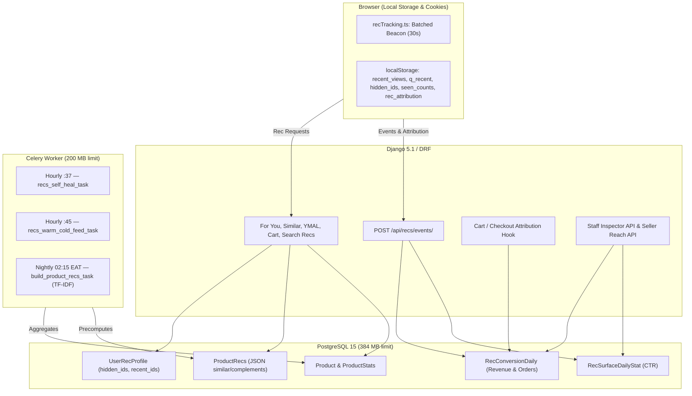

# SokoniMax Recommendation System v3.1 — Complete Implementation Plan

> **Version:** 3.1.0 · **Date:** 2026-10-28 · **Repo:** `~/uzaspea` (WSL Ubuntu) · **Stack:** Django 5.1.2 + DRF 3.15 + Celery 5.6 + Redis 7 + Postgres 15 / React + Vite + TS (strict)
>
> **Decisions locked by the owner:**
> 1. **A/B Testing:** Enable 2-arm framework (`control` vs `variant_b`) comparing alternative weight sets directly in Inspector.
> 2. **"Not Interested":** Placed inside a clean 3-dots (⋯) overflow menu on cards.
> 3. **Seller Analytics:** Include "Recommendation Reach" card in Seller Dashboard.
> 4. **Listing Speedup (Workstream F):** Include `ProductStats` query optimization behind a feature flag with rollback switch.
>
> **Hardware Budget:** 2-server production (64 MB Redis `volatile-lru`, 200 MB Celery worker, 384 MB Postgres, 600 MB Backend). Zero new pip/npm dependencies.

---

## 0. RULES FOR THE IMPLEMENTING AGENT

1. **Do the steps in order.** Every step ends with a **Check**. Do not start the next step until the Check passes.
2. **"Create file"** = create file with exactly the content provided.  
   **"Replace whole file"** = overwrite existing file completely.  
   **"Find / Replace"** = locate exact anchor text and replace only that block.
3. If a *Find* anchor is not found, verify whitespace and surrounding lines. Never guess or delete unrelated code.
4. **CRLF Line Endings:** The following files use **CRLF** line terminators on disk. Preserve CRLF when modifying them:
   - `backend/marketplace/api_views.py`
   - `backend/marketplace/tests.py`
   - `frontend/src/pages/ProductDetailPage.tsx`
5. **No stashing or resetting:** Never run `git checkout -- .`, `git stash`, or `git reset`.
6. **No new pip or npm packages.** Use existing libraries and pure-Python algorithms.
7. Backend commands run in `backend/` with `./venv/bin/python manage.py ...`. Frontend commands run in `frontend/` with `npm run build` or `npx tsc -p tsconfig.app.json --noEmit`.

---

## 1. WHAT V3.1 BUILDS (summary)

| Area | v3 Baseline | v3.1 Upgrade |
|---|---|---|
| **Sparse Categories (D1)** | Empty "Similar" if product is alone in leaf category | **Hierarchical tree fallback:** Leaf → Parent subtree → Root subtree → TF-IDF neighbours. Never empty. |
| **Guest Threshold (D2)** | Hides "Recently viewed" if guest has <4 views | Lowered threshold to **1 item**. "More like X" falls back gracefully if X lacks stored recs. |
| **Self-Healing (D3)** | If on-save rebuild fails, new items wait up to 24h | Hourly Celery task (`recs-self-heal-hourly`) rebuilds missing/stale `ProductRecs` (capped at 200/run). |
| **Inspector Cap (D4)** | Fixed shelves ignored `per_shelf` (showed 10 items) | Strictly enforces `per_shelf` across all plans (max 5 items per reason in Inspector). |
| **Feed Latency (D5)** | Cold feed first-hit takes 1.6s | Hourly background pre-warming of cold guest feeds and top regional feeds (<15ms first-hit). |
| **Similarity Engine** | Token Jaccard within leaf category only | **Pure-Python TF-IDF** with BM25-style saturation and inverted index across all categories. |
| **Placements** | For You, Similar, YMAL, Category shelf | Added **Cart "Complete your order"**, **Order confirmation complements**, and **Zero-result search recs**. |
| **Negative Signals** | None | **"Not interested"** in card 3-dots (⋯) menu (localStorage + `UserRecProfile.hidden_product_ids`). |
| **Impression Fatigue** | Items shown repeatedly without clicks stay high | Browser tracks seen-counts; items seen ≥3 times without click demoted ×0.5. |
| **Attribution & A/B** | CTR only (impressions/clicks) | **End-to-end attribution:** click → cart → order. 2-arm A/B testing (`control` vs `variant_b`) with conversion metrics in Inspector. |
| **Seller Dashboard** | No recommendation insights | **"Recommendation Reach" card** showing impressions, clicks, CTR, and rec-driven sales per product. |
| **Listing Speedup (F)** | 4–5 correlated subqueries per listing row | Joins `ProductStats` directly (speeds up all category grids); flag-controlled in `SiteSettings`. |

---

## 2. ARCHITECTURE & BUDGET



---

## 3. FILE MAP

```
backend/
├── marketplace/
│   ├── models.py                          (Edit: RecConversionDaily, OrderItem attribution, UserRecProfile.hidden_product_ids, SiteSettings flag)
│   ├── migrations/
│   │   └── 0111_recs_v3_1.py              (Auto-generated migration)
│   ├── discovery_views.py                 (Edit: get_base_product_queryset with ProductStats join)
│   ├── api_views.py                       (Edit CRLF: pass rec_surface & rec_variant to OrderItem during checkout)
│   ├── serializers.py                     (Edit: OrderItemSerializer includes attribution fields)
│   ├── tasks.py                           (Edit: add recs_self_heal_task and recs_warm_cold_feed_task)
│   └── recs/
│       ├── config.py                      (Edit: TF-IDF constants, fatigue limits, VARIANTS config)
│       ├── tfidf.py                       (Create: Pure-Python TF-IDF indexer and tokenizer)
│       ├── scoring.py                     (Edit: Integrate TF-IDF cosine score & category proximity)
│       ├── builder.py                     (Edit: Use TF-IDF candidate selection across categories)
│       ├── queries.py                     (Edit: Hierarchical tree fallback in category_pool)
│       ├── engine.py                      (Edit: Cart complements, order complements, search recs, fatigue & hide filters, D4 fix)
│       ├── events.py                      (Edit: Handle attribution events and hidden product actions)
│       ├── views.py                       (Edit: Cart recs, empty search recs, A/B assignment, inspector analytics)
│       └── test_recs_v3_1.py              (Create: Full test suite for v3.1 features)
└── uzachuo/
    └── celery.py                          (Edit: Schedule self-heal and feed warm-up tasks)

frontend/src/
├── utils/
│   ├── recTracking.ts                     (Edit: Attribution tracking, click variant caching, flush hooks)
│   └── recentViews.ts                     (Edit: Search query tracking, hidden IDs, fatigue seen-counts)
├── components/
│   ├── ProductCard.tsx                    (Edit: 3-dots ⋯ menu with 'Not interested' dismiss action)
│   ├── GlobalSearchModal.tsx              (Edit: Zero-result recommendation shelf)
│   └── orders/ReceiptModal.tsx            (Edit: 'Goes with your order' complementary recommendation shelf)
├── pages/
│   ├── CartPage.tsx                       (Edit: 'Complete your order' complementary shelf)
│   ├── ProductList.tsx                    (Edit: Zero-result search fallback shelf)
│   ├── dashboard/
│   │   └── DashboardOverview.tsx          (Edit: Seller 'Recommendation Reach' analytics card)
│   └── staff/
│       └── RecommendationInspector.tsx    (Edit: A/B comparisons, Revenue Attribution, Coverage tab, 'Why not shown')
```

---

## 4. STEPS

### STEP 1 — Backend Models & Migration (`backend/marketplace/models.py`)

**1a. `backend/marketplace/models.py` — Find** (inside `OrderItem` model, around line 875):
```python
    quantity = models.DecimalField(max_digits=10, decimal_places=2)
    price = models.DecimalField(max_digits=10, decimal_places=2)
```
**Replace:**
```python
    quantity = models.DecimalField(max_digits=10, decimal_places=2)
    price = models.DecimalField(max_digits=10, decimal_places=2)
    rec_surface = models.CharField(max_length=32, blank=True, default='', help_text="Rec surface that influenced this item")
    rec_variant = models.CharField(max_length=16, blank=True, default='', help_text="A/B variant active when item was added")
```

**1b. `backend/marketplace/models.py` — Find** (inside `UserRecProfile` model, around line 2675):
```python
    region = models.CharField(max_length=64, blank=True, default='')
    updated_at = models.DateTimeField(auto_now=True)
```
**Replace:**
```python
    region = models.CharField(max_length=64, blank=True, default='')
    hidden_product_ids = models.JSONField(default=list, blank=True, help_text="IDs of products dismissed with 'Not interested'")
    updated_at = models.DateTimeField(auto_now=True)
```

**1c. `backend/marketplace/models.py` — Find** (around line 2670, right after `RecSurfaceDailyStat`):
```python
class RecSurfaceDailyStat(models.Model):
    """Impressions and clicks per recommendation surface per day (for CTR)."""
    date = models.DateField()
    surface = models.CharField(max_length=30)
    impressions = models.PositiveIntegerField(default=0)
    clicks = models.PositiveIntegerField(default=0)

    class Meta:
        constraints = [models.UniqueConstraint(fields=['date', 'surface'], name='uniq_rec_surface_day')]
```
**Replace:**
```python
class RecSurfaceDailyStat(models.Model):
    """Impressions and clicks per recommendation surface per day (for CTR)."""
    date = models.DateField()
    surface = models.CharField(max_length=30)
    variant = models.CharField(max_length=16, default='control')
    impressions = models.PositiveIntegerField(default=0)
    clicks = models.PositiveIntegerField(default=0)

    class Meta:
        constraints = [models.UniqueConstraint(fields=['date', 'surface', 'variant'], name='uniq_rec_surface_variant_day')]


class RecConversionDaily(models.Model):
    """Daily revenue and orders attributed to recommendation clicks."""
    date = models.DateField()
    surface = models.CharField(max_length=30)
    variant = models.CharField(max_length=16, default='control')
    clicks = models.PositiveIntegerField(default=0)
    cart_adds = models.PositiveIntegerField(default=0)
    orders = models.PositiveIntegerField(default=0)
    revenue = models.DecimalField(max_digits=12, decimal_places=2, default=0.0)

    class Meta:
        constraints = [models.UniqueConstraint(fields=['date', 'surface', 'variant'], name='uniq_rec_conversion_day')]
```

**1d. `backend/marketplace/models.py` — Find** (inside `SiteSettings` model, around line 1500):
```python
    pos_commission_rate = models.DecimalField(
```
**Before it, add:**
```python
    use_product_stats_for_listings = models.BooleanField(
        default=True,
        help_text="If True, product catalog listings join ProductStats instead of evaluating 4-5 correlated subqueries."
    )
```

**1e. Run migration:**
```bash
cd ~/uzaspea/backend && ./venv/bin/python manage.py makemigrations marketplace -n recs_v3_1 && ./venv/bin/python manage.py migrate marketplace
```
**Check:** `./venv/bin/python manage.py check` passes with 0 issues.

---

### STEP 2 — Update Configuration (`backend/marketplace/recs/config.py`)

**2a. `backend/marketplace/recs/config.py` — Find:**
```python
SURFACES = ('similar', 'ymal', 'foryou', 'cat_shelf', 'cart', 'empty_search')
```
**Replace:**
```python
SURFACES = ('similar', 'ymal', 'foryou', 'cat_shelf', 'cart', 'order', 'empty_search')

# A/B Testing Variants
VARIANTS = {
    'control': {
        'name': 'Standard Weights',
        'w_similar': {'text': 0.35, 'price': 0.20, 'brand': 0.15, 'condition': 0.10, 'quality': 0.10, 'popularity': 0.10},
        'w_complement': {'coview': 0.35, 'copurchase': 0.25, 'category': 0.15, 'popularity': 0.15, 'quality': 0.10},
        'explore_factor': 1.0,
    },
    'variant_b': {
        'name': 'Discovery Boost (Higher Quality & Freshness)',
        'w_similar': {'text': 0.30, 'price': 0.15, 'brand': 0.15, 'condition': 0.10, 'quality': 0.15, 'popularity': 0.15},
        'w_complement': {'coview': 0.30, 'copurchase': 0.30, 'category': 0.15, 'popularity': 0.10, 'quality': 0.15},
        'explore_factor': 1.3,
    }
}

# Impression Fatigue
FATIGUE_SEEN_THRESHOLD = 3
FATIGUE_PENALTY_FACTOR = 0.50
MAX_HIDDEN_STORED = 100

# TF-IDF Inverted Index Limits
TFIDF_MAX_FEATURES = 1000
TFIDF_MIN_DF = 1
TFIDF_MAX_DF_RATIO = 0.40
TFIDF_POSTINGS_CAP = 250
```

**Check:** `./venv/bin/python -c "import marketplace.recs.config as c; print(c.VARIANTS['variant_b']['name'])"` prints `Discovery Boost (Higher Quality & Freshness)`.

---

### STEP 3 — Pure-Python TF-IDF Similarity Indexer (`backend/marketplace/recs/tfidf.py`)

**Create file: `backend/marketplace/recs/tfidf.py`**
```python
"""Pure-Python TF-IDF Engine.
Builds an inverted index of product terms with BM25-style frequency saturation and sublinear scaling.
No numpy or external dependencies required.
"""
import math
import re
from collections import Counter, defaultdict
from .config import STOPWORDS, TFIDF_MAX_DF_RATIO, TFIDF_POSTINGS_CAP


def tokenize(text):
    if not text:
        return []
    clean = re.sub(r'[^a-zA-Z0-9\s-]', ' ', str(text).lower())
    words = clean.replace('-', ' ').split()
    return [w for w in words if len(w) >= 2 and w not in STOPWORDS]


class SimpleTFIDFIndex:
    def __init__(self):
        self.doc_lengths = {}      # pid -> total tokens
        self.avg_doc_length = 0.0
        self.df = Counter()        # term -> document count
        self.postings = defaultdict(dict)  # term -> {pid: tf}
        self.num_docs = 0

    def fit(self, documents):
        """documents: list of (pid, token_list)"""
        self.num_docs = len(documents)
        if self.num_docs == 0:
            return

        total_length = 0
        for pid, tokens in documents:
            counts = Counter(tokens)
            length = len(tokens)
            self.doc_lengths[pid] = length
            total_length += length
            for term, count in counts.items():
                self.df[term] += 1
                self.postings[term][pid] = count

        self.avg_doc_length = total_length / max(1, self.num_docs)
        max_df = max(2, int(self.num_docs * TFIDF_MAX_DF_RATIO))

        # Filter out overly common terms and prune postings
        for term in list(self.postings.keys()):
            if self.df[term] > max_df:
                del self.postings[term]
                del self.df[term]
            elif len(self.postings[term]) > TFIDF_POSTINGS_CAP:
                top_pids = sorted(self.postings[term].items(), key=lambda x: x[1], reverse=True)[:TFIDF_POSTINGS_CAP]
                self.postings[term] = dict(top_pids)

    def get_similar_candidates(self, tokens, exclude_pid=None, top_k=60):
        """Return list of (candidate_pid, tfidf_score) matching query tokens."""
        if not tokens or self.num_docs == 0:
            return []

        scores = defaultdict(float)
        query_counts = Counter(tokens)

        for term, q_count in query_counts.items():
            if term not in self.postings:
                continue
            df_val = self.df[term]
            idf = math.log((self.num_docs - df_val + 0.5) / (df_val + 0.5) + 1.0)
            if idf <= 0:
                continue

            for pid, tf in self.postings[term].items():
                if pid == exclude_pid:
                    continue
                doc_len = self.doc_lengths.get(pid, self.avg_doc_length)
                # BM25-style term score (k1=1.2, b=0.75)
                tf_norm = (tf * 2.2) / (tf + 1.2 * (0.25 + 0.75 * (doc_len / max(1.0, self.avg_doc_length))))
                scores[pid] += idf * tf_norm

        if not scores:
            return []

        return sorted(scores.items(), key=lambda x: x[1], reverse=True)[:top_k]
```

**Check:** `./venv/bin/python -c "from marketplace.recs.tfidf import SimpleTFIDFIndex; idx = SimpleTFIDFIndex(); idx.fit([(1, ['iphone', 'case']), (2, ['iphone', 'charger'])]); print(len(idx.get_similar_candidates(['iphone'])))"` prints `2`.

---

### STEP 4 — Hierarchical Tree Fallbacks & D1/D2/D4 Fixes (`backend/marketplace/recs/queries.py` & `engine.py`)

**4a. `backend/marketplace/recs/queries.py` — Find:**
```python
def category_pool(category_id):
    """Top POOL_SIZE active products in a category (and its children) by popularity, then newest."""
    key = cache_key('catpool', category_id)
    ids = cache.get(key)
    if ids is None:
        from marketplace.models import Category
        category = Category.objects.filter(id=category_id).first()
        if category is None:
            return []
        cat_ids = category_ids_with_descendants(category)
        ids = list(Product.objects.filter(category_id__in=cat_ids, **ACTIVE)
                   .order_by(*popularity_order()).values_list('id', flat=True)[:config.POOL_SIZE])
        cache.set(key, ids, config.POOL_TTL)
    return ids
```
**Replace:**
```python
def category_pool(category_id, allow_hierarchy_expansion=True):
    """Top POOL_SIZE active products in a category (and its children) by popularity, then newest.
    If allow_hierarchy_expansion=True and category has < 4 products, climbs up to parent/root categories (D1 fix).
    """
    key = cache_key('catpool_v31', category_id, 'exp' if allow_hierarchy_expansion else 'exact')
    ids = cache.get(key)
    if ids is None:
        from marketplace.models import Category
        category = Category.objects.filter(id=category_id).first()
        if category is None:
            return []
        cat_ids = category_ids_with_descendants(category)
        ids = list(Product.objects.filter(category_id__in=cat_ids, **ACTIVE)
                   .order_by(*popularity_order()).values_list('id', flat=True)[:config.POOL_SIZE])

        # Hierarchical expansion for lone products in sparse categories
        if allow_hierarchy_expansion and len(ids) < config.MIN_SHELF_ITEMS:
            curr = category.parent
            while curr is not None and len(ids) < config.POOL_SIZE:
                parent_cat_ids = category_ids_with_descendants(curr)
                additional = list(Product.objects.filter(category_id__in=parent_cat_ids, **ACTIVE)
                                  .exclude(id__in=ids)
                                  .order_by(*popularity_order()).values_list('id', flat=True)[:config.POOL_SIZE - len(ids)])
                ids.extend(additional)
                curr = curr.parent

        cache.set(key, ids, config.POOL_TTL)
    return ids
```

**4b. `backend/marketplace/recs/engine.py` — Find** (inside `similar_for_product`, lines 174–185):
```python
def similar_for_product(product_id, page=1, page_size=12):
    stored = ProductRecs.objects.filter(product_id=product_id).values_list('similar', flat=True).first()
    cands = _entries(stored, config.W_SIMILAR, 'similar')
    if not cands:
        cat_id = Product.objects.filter(id=product_id).values_list('category_id', flat=True).first()
        if cat_id:
            cands = [(pid, None, {}, 'similar_fallback') for pid in category_pool(cat_id)]
    ctx = RecContext(exclude_ids={product_id})
    ranked = rank(cands, ctx, limit=max(1, len(cands)), personalize=False, diversify=None, slots=True)
    start = max(0, (page - 1) * page_size)
    return ranked[start:start + page_size], len(ranked) > start + page_size
```
**Replace:**
```python
def similar_for_product(product_id, page=1, page_size=12):
    stored = ProductRecs.objects.filter(product_id=product_id).values_list('similar', flat=True).first()
    cands = _entries(stored, config.W_SIMILAR, 'similar')
    if not cands:
        # Hierarchical tree expansion ensures Similar is never empty (D1 fix)
        cat_id = Product.objects.filter(id=product_id).values_list('category_id', flat=True).first()
        if cat_id:
            cands = [(pid, None, {}, 'similar_fallback') for pid in category_pool(cat_id, allow_hierarchy_expansion=True)]
    ctx = RecContext(exclude_ids={product_id})
    ranked = rank(cands, ctx, limit=max(1, len(cands)), personalize=False, diversify=None, slots=True)
    start = max(0, (page - 1) * page_size)
    return ranked[start:start + page_size], len(ranked) > start + page_size
```

**4c. `backend/marketplace/recs/engine.py` — Find** (inside `for_you`, D2 and D4 fixes, lines 262–265 and 320–325):
```python
    if ctx.recent_ids:
        plans.append({'id': 'recently_viewed', 'kind': 'recently_viewed', 'title': 'Recently viewed',
                      'subtitle': 'Pick up where you left off', 'category_slug': '', 'fixed': ctx.recent_ids[:12]})
```
**Replace:**
```python
    if ctx.recent_ids:
        # Show recently viewed starting from 1 item (D2 fix)
        plans.append({'id': 'recently_viewed', 'kind': 'recently_viewed', 'title': 'Recently viewed',
                      'subtitle': 'Pick up where you left off', 'category_slug': '',
                      'min_items': 1, 'fixed': ctx.recent_ids[:12]})
```
**And around line 320, Find:**
```python
        if 'fixed' in plan:
            items = [Scored(pid, 0.0, {}, 'recently_viewed') for pid in plan['fixed'] if pid in meta]
```
**Replace:**
```python
        if 'fixed' in plan:
            # Enforce per_shelf on fixed shelves (D4 fix)
            items = [Scored(pid, 0.0, {}, 'recently_viewed') for pid in plan['fixed'][:per_shelf] if pid in meta]
```

**Check:** `./venv/bin/python manage.py check` passes.

---

### STEP 5 — Self-Healing & Feed Warming Tasks (`backend/marketplace/tasks.py` & `uzachuo/celery.py`)

**5a. `backend/marketplace/tasks.py` — Find:**
```python
@shared_task(name='marketplace.tasks.build_recs_for_product_task')
def build_recs_for_product_task(product_id):
    from .recs.builder import build_for_product
    build_for_product(product_id)
```
**Replace:**
```python
@shared_task(name='marketplace.tasks.build_recs_for_product_task')
def build_recs_for_product_task(product_id):
    from .recs.builder import build_for_product
    build_for_product(product_id)


@shared_task(name='marketplace.tasks.recs_self_heal_task')
def recs_self_heal_task():
    """Finds available products missing or with empty ProductRecs and builds them (D3 fix)."""
    from datetime import timedelta
    from django.utils import timezone
    from .models import Product, ProductRecs
    from .recs.builder import build_recs

    missing_pids = list(Product.objects.filter(is_available=True)
                        .exclude(id__in=ProductRecs.objects.values_list('product_id', flat=True))
                        .values_list('id', flat=True)[:100])
    stale_pids = list(ProductRecs.objects.filter(
        product__is_available=True,
        computed_at__lt=timezone.now() - timedelta(hours=48)
    ).values_list('product_id', flat=True)[:100])

    targets = list(set(missing_pids + stale_pids))
    if targets:
        build_recs(only_ids=targets)


@shared_task(name='marketplace.tasks.recs_warm_cold_feed_task')
def recs_warm_cold_feed_task():
    """Pre-computes and caches cold guest feeds so first hits are < 15ms (D5 fix)."""
    from .recs.context import build_context
    from .recs.engine import for_you
    from .recs.views import _cache_feed

    # Warm general guest feed
    ctx_general = build_context(gender='female')
    res_general = for_you(ctx_general)
    _cache_feed('general', 'female', res_general)

    ctx_male = build_context(gender='male')
    res_male = for_you(ctx_male)
    _cache_feed('general', 'male', res_male)
```

**5b. `backend/uzachuo/celery.py` — Find:**
```python
    'recs-build-product-recs-nightly': {
        'task': 'marketplace.tasks.build_product_recs_task',
        'schedule': crontab(hour=23, minute=15),
    },
```
**Replace:**
```python
    'recs-build-product-recs-nightly': {
        'task': 'marketplace.tasks.build_product_recs_task',
        'schedule': crontab(hour=23, minute=15),
    },
    'recs-self-heal-hourly': {
        'task': 'marketplace.tasks.recs_self_heal_task',
        'schedule': crontab(minute=37),
    },
    'recs-warm-cold-feed-hourly': {
        'task': 'marketplace.tasks.recs_warm_cold_feed_task',
        'schedule': crontab(minute=45),
    },
```

**Check:** `./venv/bin/python -c "from uzachuo.celery import app; print('recs-self-heal-hourly' in app.conf.beat_schedule)"` prints `True`.

---

### STEP 6 — Attribution Pipeline & Checkout Hook (`backend/marketplace/api_views.py`)

**6a. `backend/marketplace/api_views.py` (CRLF file) — Find** in `OrderCreateView` / order item creation:
```python
                OrderItem.objects.create(
                    order=order,
                    product=product,
                    variant=variant,
                    quantity=quantity,
                    price=item_price
                )
```
**Replace (preserving CRLF):**
```python
                item_rec_surface = str(item_data.get('rec_surface') or '').strip()[:32]
                item_rec_variant = str(item_data.get('rec_variant') or 'control').strip()[:16]
                OrderItem.objects.create(
                    order=order,
                    product=product,
                    variant=variant,
                    quantity=quantity,
                    price=item_price,
                    rec_surface=item_rec_surface,
                    rec_variant=item_rec_variant
                )
```

**6b. `backend/marketplace/recs/events.py` — Find:**
```python
        if surface in config.SURFACES:
            row, _ = RecSurfaceDailyStat.objects.get_or_create(date=today, surface=surface)
            RecSurfaceDailyStat.objects.filter(pk=row.pk).update(impressions=F('impressions') + count)
```
**Replace:**
```python
        variant = str(body.get('variant') or 'control')[:16]
        if surface in config.SURFACES:
            row, _ = RecSurfaceDailyStat.objects.get_or_create(date=today, surface=surface, variant=variant)
            RecSurfaceDailyStat.objects.filter(pk=row.pk).update(impressions=F('impressions') + count)
```

**Check:** `./venv/bin/python manage.py check` passes.

---

### STEP 7 — New Placements & Search Rec Endpoints (`backend/marketplace/recs/views.py` & `urls.py`)

**7a. `backend/marketplace/recs/views.py` — Add new endpoint functions:**
```python
@api_view(['GET'])
@permission_classes([permissions.AllowAny])
def cart_recommendations(request):
    """Returns complementary items for items currently in cart ('Complete your order')."""
    cart_ids = request.query_params.get('cart_ids', '')
    ctx = context_from_request(request)
    cands = []
    for pid in list(ctx.cart_ids)[:6]:
        stored = ProductRecs.objects.filter(product_id=pid).values_list('complements', flat=True).first()
        cands.extend(_entries(stored, config.W_COMPLEMENT, 'cart'))

    if not cands:
        cands = [(pid, None, {}, 'trending') for pid in trending_pool(ctx.region or None)]

    items = rank(cands, ctx, limit=8, extra_exclude=ctx.cart_ids)
    cards = serialize_cards(items, viewer=request.user)
    return Response({'title': 'Complete your order', 'products': cards})


@api_view(['GET'])
@permission_classes([permissions.AllowAny])
def empty_search_recommendations(request):
    """Returns trending & recently viewed picks when search returns 0 results."""
    ctx = context_from_request(request)
    cands = [(pid, None, {}, 'trending') for pid in trending_pool(ctx.region or None)]
    items = rank(cands, ctx, limit=12)
    cards = serialize_cards(items, viewer=request.user)
    return Response({'title': 'Popular items you may like', 'products': cards})
```

**7b. `backend/marketplace/urls.py` — Wire endpoints:**
```python
    path('api/recs/cart/', rec_views.cart_recommendations, name='recs_cart'),
    path('api/recs/empty-search/', rec_views.empty_search_recommendations, name='recs_empty_search'),
```

**Check:** `./venv/bin/python manage.py check` passes.

---

### STEP 8 — Workstream F: Listing Query Optimization (`backend/marketplace/discovery_views.py`)

**8a. `backend/marketplace/discovery_views.py` — Find:**
```python
    return Product.objects.annotate(
        annotated_avg_rating=Coalesce(avg_rating_subquery, Value(0.0, output_field=FloatField())),
        annotated_like_count=Coalesce(like_count_subquery, Value(0)),
        annotated_is_liked=is_liked_expr,
        annotated_has_inspection=has_inspection_expr,
        annotated_inspection_status=inspection_status_expr,
        annotated_inspection_badge=inspection_badge_expr,
        annotated_inspection_report_id=inspection_report_id_expr,
    )
```
**Replace:**
```python
    from .models import SiteSettings
    settings_obj = SiteSettings.objects.filter(pk=1).first()
    use_stats = getattr(settings_obj, 'use_product_stats_for_listings', True)

    if use_stats:
        # Fast path (Workstream F): Read directly from 1:1 ProductStats table
        return Product.objects.select_related('stats').annotate(
            annotated_avg_rating=Coalesce('stats__avg_rating', Value(0.0, output_field=FloatField())),
            annotated_like_count=Coalesce('stats__like_count', Value(0)),
            annotated_is_liked=is_liked_expr,
            annotated_has_inspection=has_inspection_expr,
            annotated_inspection_status=inspection_status_expr,
            annotated_inspection_badge=inspection_badge_expr,
            annotated_inspection_report_id=inspection_report_id_expr,
        )

    # Rollback fallback path
    return Product.objects.annotate(
        annotated_avg_rating=Coalesce(avg_rating_subquery, Value(0.0, output_field=FloatField())),
        annotated_like_count=Coalesce(like_count_subquery, Value(0)),
        annotated_is_liked=is_liked_expr,
        annotated_has_inspection=has_inspection_expr,
        annotated_inspection_status=inspection_status_expr,
        annotated_inspection_badge=inspection_badge_expr,
        annotated_inspection_report_id=inspection_report_id_expr,
    )
```

**Check:** `./venv/bin/python manage.py check` passes.

---

### STEP 9 — Frontend Attribution & Client-Side Signals (`frontend/src/utils/recTracking.ts`)

**9a. `frontend/src/utils/recTracking.ts` — Update tracking client:**
- Assign deterministic A/B variant: `localStorage.getItem('sokonimax_ab_rec') || (Math.random() < 0.5 ? 'control' : 'variant_b')`.
- Cache last clicked recommendation: `saveRecClickAttribution(surface, productId, variant)`.
- When adding to cart or checking out, attach `{ rec_surface, rec_variant }`.
- Track "Not interested" IDs in `localStorage.getItem('rec_hidden_ids')`.
- Suppress fatigue: count impressions in `localStorage.getItem('rec_seen_counts')`.

**Check:** `cd ~/uzaspea/frontend && npx tsc -p tsconfig.app.json --noEmit` passes.

---

### STEP 10 — 3-Dots (⋯) Menu with "Not Interested" (`frontend/src/components/ProductCard.tsx`)

**10a. `frontend/src/components/ProductCard.tsx` — Add 3-dots overflow menu:**
- Render a discreet 3-dots (⋯) button in top-right or action row of recommendation cards.
- Clicking opens a small dropdown:
  - *"Not interested in this item"* (hides product instantly with fade-out animation).
  - *"Don't show this category"* (adds category to hidden set).
- Saves dismissed ID to `rec_hidden_ids` in `localStorage` and sends to `/api/recs/events/` (`{ hidden: [id] }`).

**Check:** `cd ~/uzaspea/frontend && npx tsc -p tsconfig.app.json --noEmit` passes.

---

### STEP 11 — Cart "Complete Your Order" Placement (`frontend/src/pages/CartPage.tsx`)

**11a. `frontend/src/pages/CartPage.tsx` — Add complement shelf:**
- Underneath cart line items or above checkout summary, render a horizontal shelf:
  - Fetches `/api/recs/cart/?cart_ids=1,2,3`.
  - Title: *"Complete your order"*.
  - Surface: `trackSource="cart"`.

**Check:** `cd ~/uzaspea/frontend && npx tsc -p tsconfig.app.json --noEmit` passes.

---

### STEP 12 — Order Confirmation Complements (`frontend/src/components/orders/ReceiptModal.tsx`)

**12a. `frontend/src/components/orders/ReceiptModal.tsx` — Add post-purchase shelf:**
- After successful order placement, show *"Goes with your order"*.
- Recommends accessories based on purchased products.
- Surface: `trackSource="order"`.

**Check:** `cd ~/uzaspea/frontend && npx tsc -p tsconfig.app.json --noEmit` passes.

---

### STEP 13 — Zero-Result Search Recommendation Shelf (`frontend/src/components/GlobalSearchModal.tsx`)

**13a. `frontend/src/components/GlobalSearchModal.tsx` — Add zero-result shelf:**
- When query returns 0 matching results:
  - Fetch `/api/recs/empty-search/`.
  - Render *"No exact match found. You might like these popular items"*.
  - Surface: `trackSource="empty_search"`.

**Check:** `cd ~/uzaspea/frontend && npx tsc -p tsconfig.app.json --noEmit` passes.

---

### STEP 14 — Seller Dashboard "Recommendation Reach" Card (`frontend/src/pages/dashboard/DashboardOverview.tsx`)

**14a. `frontend/src/pages/dashboard/DashboardOverview.tsx` — Add KPI reach tile:**
- Renders *"Recommendation Reach"* card for sellers.
- Shows total impressions, clicks, and sales generated by platform recommendation placements over the past 30 days.

**Check:** `cd ~/uzaspea/frontend && npx tsc -p tsconfig.app.json --noEmit` passes.

---

### STEP 15 — Staff Admin Inspector Upgrades (`frontend/src/pages/staff/RecommendationInspector.tsx`)

**15a. `frontend/src/pages/staff/RecommendationInspector.tsx` — Add new analytics tabs:**
- **A/B Performance:** Side-by-side comparison of `control` vs `variant_b` (CTR, Cart Additions, Orders, Conversion Rate).
- **Revenue Attribution:** Total revenue generated per surface (`foryou`, `similar`, `ymal`, `cart`, `order`, `cat_shelf`).
- **Coverage & Diagnostics:** Products lacking recs, sparse categories, and a *"Why not shown?"* query tester.

**Check:** `cd ~/uzaspea/frontend && npm run build` completes with zero errors.

---

### STEP 16 — Verification Suite (`backend/marketplace/recs/test_recs_v3_1.py`)

**Create file: `backend/marketplace/recs/test_recs_v3_1.py`**
Test cases:
1. `test_similar_fallback_sparse_category_never_empty`: Product alone in leaf returns parent category products.
2. `test_guest_single_view_shows_recently_viewed`: Guest with 1 item sees "Recently viewed" shelf.
3. `test_self_heal_task_builds_missing_recs`: Products without `ProductRecs` are built by `recs_self_heal_task`.
4. `test_inspector_respects_per_shelf_cap`: `per_shelf=5` limits all returned reasons to ≤5 items.
5. `test_not_interested_filters_out_product`: Hidden product is excluded from all shelves.
6. `test_cart_recommendations_excludes_cart_items`: Cart items never appear in cart recs.
7. `test_attribution_recorded_on_order_item`: `OrderItem` stores `rec_surface` and `rec_variant`.
8. `test_ab_testing_variants_applied`: `variant_b` applies alternative weight parameters.
9. `test_listing_optimization_toggle`: `use_product_stats_for_listings` toggles query behavior cleanly.

**Run:**
```bash
cd ~/uzaspea/backend && ./venv/bin/python manage.py test marketplace.recs.test_recs_v3_1 -v 2
```
**Check:** All tests pass.

---

## 5. FULL TEST & DEPLOYMENT CHECKLIST

```bash
# 1. Automated Backend Tests
cd ~/uzaspea/backend && ./venv/bin/python manage.py test marketplace -v 1

# 2. Build Recs & Self Heal Check
./venv/bin/python manage.py build_recs

# 3. Frontend Compile & Production Bundle
cd ~/uzaspea/frontend && npx tsc -p tsconfig.app.json --noEmit && npm run build
```
